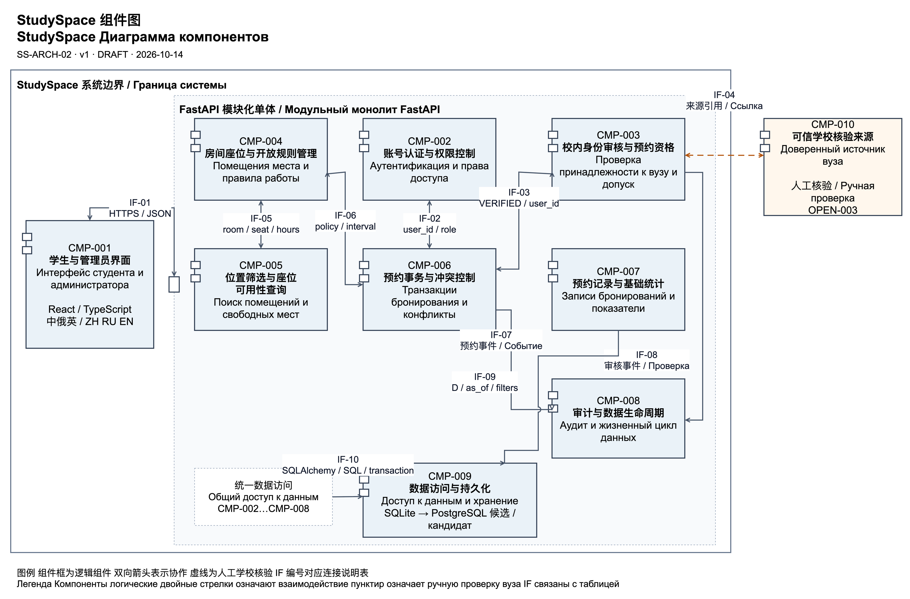

StudySpace 组件候选与组件图
StudySpace Кандидаты и диаграмма компонентов

Doc-ID SS-ARCH-03  |  v2  |  2026-10-14  |  DRAFT  |  组件候选／Кандидаты PROPOSED

本文件统一组件候选的职责、需求与场景来源，并结合组件图说明连接协议、数据和事务边界；正式表与图使用相同的 10 个组件编号。
Документ объединяет ответственность, требования и сценарии кандидатов и поясняет протоколы, данные и границы транзакций по диаграмме; таблица и схема используют одинаковые 10 ID компонентов.

1 两份候选表的编号对应
1 Сопоставление ID двух таблиц

SS-COMP-01 v1 的 8 项划分中，资源与可用性、数据存储与恢复采用较粗粒度；本版按 SS-ARCH-01 及组件图的 10 项划分统一。下表的左列只表示原 8 项表中的编号。
В SS-COMP-01 v1 из 8 кандидатов ресурсы с доступностью и хранение с восстановлением сгруппированы крупнее; версия следует 10 кандидатам SS-ARCH-01 и схемы; левая колонка обозначает ID только исходной таблицы из 8 кандидатов.

| 原 8 项表 Исходные 8 | 统一表与图 Единая таблица и схема | 职责对应 Соответствие ответственности |
| --- | --- | --- |

| SS-COMP-01 CMP-001…003 | CMP-001…003 | 界面、认证和校内审核分别对应，保持原有职责。 Интерфейс, аутентификация и проверка вуза соответствуют по порядку с сохранением ответственности. |

| SS-COMP-01 CMP-004 | CMP-004 + CMP-005 | 资源与可用性分为房间座位及开放规则管理、位置筛选与空闲座位查询。 Ресурсы и доступность разделены на ведение помещений мест и часов и поиск свободных мест. |

| SS-COMP-01 CMP-005 | CMP-006 | 预约事务对应图中的预约事务与冲突控制。 Транзакции бронирования соответствуют компоненту транзакций и конфликтов на схеме. |

| SS-COMP-01 CMP-006 | CMP-007 | 预约记录与统计对应图中的记录和基础统计。 Записи и статистика соответствуют записям и базовым показателям на схеме. |

| SS-COMP-01 CMP-007 | CMP-008 + CMP-009 | 数据存储与恢复分为审计及生命周期策略、数据访问与持久化及迁移支持。 Хранение и восстановление разделены на аудит и жизненный цикл и доступ хранение и поддержку миграции. |

| SS-COMP-01 CMP-008 | CMP-010 | 可信学校核验来源保持为外部人工核验依赖。 Доверенный источник вуза сохраняется как внешняя зависимость ручной проверки. |

需求基线为课堂需求登记 v0.2；SP-BR 是课堂业务需求，与工程 BR 业务规则分别编号。
Требования Учебный реестр v0.2; учебные бизнес-потребности SP-BR и инженерные бизнес-правила BR имеют отдельные ID.

场景来源为用户故事待办 v1 的 US、EN 条目；设计依据为系统设计 0.3.0、DEC-016 与 OPEN-003。
Сценарии Элементы US и EN бэклога v1; проектирование Проект системы 0.3.0, DEC-016 и OPEN-003.

2 统一组件候选表
2 Единая таблица кандидатов

共 10 个候选，9 个内部组件和 1 个外部学校核验依赖；各语言的职责均用一句话表述，来源汇总两份表的需求 ID 与用户故事。
Всего 10 кандидатов: 9 внутренних и один внешний источник вуза; ответственность на каждом языке задана одним предложением, источники объединяют требования и истории обеих таблиц.

| 候选组件 Кандидат | 职责 一句话 Ответственность одним предложением | 来源 需求与场景 Источник требования и сценарии | 内部／外部 Внутренний или внешний |
| --- | --- | --- | --- |

| CMP-001 学生与管理员界面 Интерфейс студента и администратора | 向学生和管理员提供查询、预约、取消、审核及管理的中俄英界面，并通过统一业务 API 展示结果。 Предоставляет студенту и администратору интерфейс поиска, бронирования, отмены, проверки и управления на китайском, русском и английском языках с результатами через единый бизнес API. | SP-C-004, SP-IF-001, SP-NFR-006 US-001, US-002, US-003, US-004, US-005, US-006, US-015 用户在手机或电脑上切换语言并完成对应角色的操作。 Пользователь меняет язык и выполняет действия своей роли на телефоне или компьютере. | 内部 Внутренний |

| CMP-002 账号认证与权限控制 Аутентификация и права доступа | 管理学生注册、登录退出、首位管理员创建和账号角色，并在服务端校验账号输入及受限操作权限。 Управляет регистрацией, входом и выходом, созданием первого администратора и ролями и проверяет на сервере данные аккаунта и права закрытых операций. | SP-FR-001, SP-FR-002, SP-FR-003, SP-FR-004, SP-FR-026, SP-FR-031, SP-NFR-009, SP-NFR-010 EN-001, US-004, US-007, US-008 学生登录后不能调用管理接口，注册也不能自授管理员角色。 Студент после входа не вызывает административные операции и не присваивает себе роль администратора при регистрации. | 内部 Внутренний |

| CMP-003 校内身份审核与预约资格 Проверка принадлежности к вузу и допуск | 依据可信学校来源维护校内审核状态，并协调停用或身份变更时取消未结束预约。 Ведёт статус проверки по доверенному источнику вуза и координирует отмену незавершённых записей при отключении аккаунта или изменении идентификационных данных. | SP-BR-003, SP-DR-001, SP-FR-020, SP-FR-021, SP-FR-022, SP-IF-002, SP-NFR-004 US-004 管理员核验后授予 VERIFIED；没有可信来源时不予通过。 Администратор присваивает VERIFIED после проверки; без доверенного источника подтверждение запрещено. | 内部 Внутренний |

| CMP-004 房间座位与开放规则管理 Помещения места и правила работы | 维护房间、座位、开放时间及允许调整的预约规则，并协调关闭资源时取消受影响预约。 Ведёт помещения, места, часы работы и разрешённые настройки бронирования и координирует отмену затронутых записей при закрытии ресурсов. | SP-C-003, SP-FR-006, SP-FR-014, SP-FR-015, SP-FR-016, SP-FR-017, SP-FR-018, SP-NFR-004 US-001, US-005, US-009 管理员停用座位或缩减开放时段时，在同一事务取消受影响的未结束预约。 Отключение места или сокращение часов атомарно отменяет затронутые незавершённые записи. | 内部 Внутренний |

| CMP-005 位置筛选与座位可用性查询 Поиск помещений и свободных мест | 按位置、业务日期和合法时段筛选资源，返回启用且无重叠预约的空闲座位。 Фильтрует ресурсы по расположению, деловой дате и допустимому интервалу и возвращает активные свободные места без пересекающихся записей. | SP-C-003, SP-FR-005, SP-FR-006, SP-FR-007, SP-NFR-002 US-001, US-005, US-009 学生按校区、日期和时段查找座位，已占用或停用座位不出现在结果中。 Студент ищет место по кампусу, дате и времени; занятые и отключённые места исключены из результата. | 内部 Внутренний |

| CMP-006 预约事务与冲突控制 Транзакции бронирования и конфликты | 在同一服务端事务内完成资格与时间校验、重叠检查及单座位预约创建或取消。 В одной серверной транзакции проверяет допуск, время и пересечения и создаёт либо отменяет бронирование одного места. | SP-BR-002, SP-C-001, SP-C-002, SP-FR-008, SP-FR-009, SP-FR-010, SP-FR-011, SP-FR-012, SP-FR-017, SP-NFR-004 EN-002, US-002, US-003, US-005, US-010 同学生或同座位的重叠被拒绝；相邻及多条非重叠预约允许，重复取消不重复计数。 Пересечения одного студента или места запрещены; соседние интервалы и несколько непересекающихся записей допустимы, повторная отмена не меняет счётчик. | 内部 Внутренний |

| CMP-007 预约记录与基础统计 Записи бронирований и показатели | 在权限及保留期范围内查询预约记录，并按同一业务日期及 as_of 快照计算创建、取消和未结束三项统计。 Выдаёт записи в пределах прав и срока хранения и вычисляет числа созданных, отменённых и незавершённых бронирований для одной деловой даты и снимка as_of. | SP-BR-004, SP-DR-002, SP-FR-013, SP-FR-019, SP-FR-023, SP-FR-024, SP-FR-025 US-006 学生仅见本人记录，管理员核对三项计数，保留期外数据显示不可统计。 Студент видит только своё, администратор сверяет три показателя; очищенные по сроку данные обозначаются недоступными. | 内部 Внутренний |

| CMP-008 审计与数据生命周期 Аудит и жизненный цикл данных | 记录必要审核及管理事件，并执行保留、身份清理、备份及恢复后的到期清理策略。 Регистрирует необходимые события проверки и управления и выполняет правила хранения, очистки идентификационных данных, резервирования и очистки после восстановления. | SP-DR-001, SP-DR-002, SP-DR-003, SP-FR-022, SP-NFR-003 EN-003, EN-004, EN-007 审核仅保存必要引用，不存证明影像；按既有 180 天保留和最近 7 份备份策略处理数据。 Проверка хранит необходимые ссылки без изображений документов; действуют прежние сроки 180 дней и последние 7 резервных копий. | 内部 Внутренний |

| CMP-009 数据访问与持久化 Доступ к данным и хранение | 提供账号、资源、预约及审核记录的统一持久化访问，并支持约束、锁、事务和数据库迁移。 Предоставляет единый доступ к сохранённым аккаунтам, ресурсам, бронированиям и событиям проверки с поддержкой ограничений, блокировок, транзакций и миграции БД. | SP-C-005, SP-DR-001, SP-NFR-004, SP-NFR-005, SP-TR-001 EN-002, EN-003, EN-004 沿用 SQLAlchemy；开发使用 SQLite，部署候选 PostgreSQL，迁移与回滚需分别验证。 Используется SQLAlchemy; SQLite для разработки, PostgreSQL как кандидат размещения, миграция и откат проверяются отдельно. | 内部 Внутренний |

| CMP-010 可信学校核验来源 Доверенный источник вуза | 向管理员及校内审核组件提供经学校确认、可复核的在校身份核验依据。 Предоставляет администратору и компоненту проверки подтверждённые вузом и проверяемые основания принадлежности студента к вузу. | SP-BR-003, SP-FR-022, SP-IF-002 US-004 管理员依据学校确认的渠道人工核验；具体名单或平台仍由 OPEN-003 确认。 Администратор проверяет вручную по согласованному вузом каналу; конкретный реестр или платформа уточняется в OPEN-003. | 外部 待确认来源 Внешний Источник уточняется |

3 组件边界与业务规则
3 Границы и бизнес правила

划分边界 内部指由 StudySpace 团队维护的模块，外部指学校提供的可信核验来源；数据库属于内部基础设施，单独运行不改变其归属。
Граница Внутренние модули ведёт команда StudySpace, внешний источник проверки предоставляет вуз; отдельный процесс БД остаётся внутренней инфраструктурой.

内部组件沿用模块化单体，界面调用业务 API；资源模块提供配置，查询结果仅供选择，预约创建时在服务端事务内重新校验，账号或资源变更复用预约取消逻辑。
Внутренние компоненты образуют модульный монолит, интерфейс вызывает бизнес API; ресурсы дают настройки, поиск служит выбору, создание повторяет проверки в серверной транзакции, изменения аккаунтов и ресурсов используют общую отмену.

每条预约只涉及一个座位；同学生或同座位的有效预约按 [start,end) 检查重叠，相邻和多条非重叠预约允许。查询结果仅供选择，提交时必须在服务端重新校验。
Каждая запись относится к одному месту; пересечения студента или места проверяются по [start,end), соседние и несколько непересекающихся записей допустимы; результат поиска служит выбору, при отправке сервер повторяет проверки.

创建、取消、停用账号和关闭资源由同一事务协调；CMP-006 的冲突检查、锁后时刻判定、写入与必要事件记录须原子完成。IF-10 是 CMP-002…CMP-008 的共同存储依赖汇总，不代表新增组件或独立服务。
Создание, отмена, отключение аккаунта и закрытие ресурса координируются общей транзакцией; проверки CMP-006 после блокировок, запись и необходимые события атомарны; IF-10 обобщает зависимость CMP-002…CMP-008 от хранилища, без нового компонента или отдельного сервиса.

CMP-010 是学校控制的外部核验来源，IF-04 虚线表示人工核验依赖；可采用学校认可的名单或系统，真实渠道仍由 OPEN-003 确认，不假定已有自动 API，无可信来源不得批准 VERIFIED。
CMP-010 — контролируемый вузом внешний источник, пунктир IF-04 означает ручную проверку; допустим признанный вузом список или система, фактический канал уточняется в OPEN-003, готовый API не предполагается, без доверенного источника VERIFIED запрещён.

统一候选表覆盖现有 MVP 功能需求 SP-FR-001…026 和 SP-FR-031；提醒、QR 签到、违约和实际使用率 SP-FR-027…030 属于未来范围，三项基础统计不代表真实到场，业务实现及业务测试仍未完成，NOT_RUN。
Единая таблица покрывает функциональные требования MVP SP-FR-001…026 и SP-FR-031; напоминания, QR-отметка, нарушения и фактическая загрузка SP-FR-027…030 относятся к будущему, базовые показатели не означают присутствие, реализация и бизнес-тесты не завершены, NOT_RUN.

图 1 统一编号的 StudySpace 逻辑组件与连接，沿用已绘制的组件图。
Рисунок 1 Логические компоненты и связи StudySpace с едиными ID по подготовленной схеме.

4 连接协议与传递数据
4 Протоколы и передаваемые данные

内部箭头表示同一 FastAPI 模块化单体内的调用或协作，IF-01 为界面访问业务 API 的候选契约；这些设计不表示业务接口已经实现。
Внутренние стрелки означают вызовы и взаимодействие в одном модульном монолите FastAPI, IF-01 задаёт кандидат контракта интерфейса с бизнес API; проектирование не означает реализованные интерфейсы.

| 连接 ID ID связи | 调用或协作组件 Компоненты | 协议与数据 Протокол и данные | 需求或前提来源 Требования и условия |
| --- | --- | --- | --- |

| IF-01 | CMP-001 → CMP-002, CMP-003, CMP-004, CMP-005, CMP-006, CMP-007 | HTTPS / JSON；请求携带凭据或会话信息及业务输入，响应返回结果、记录或错误；本地开发可用 HTTP。 HTTPS / JSON: запрос содержит данные входа или сессии и бизнес-поля; ответ возвращает результат, записи или ошибку; локальная разработка допускает HTTP. | SP-IF-001, SP-FR-004, SP-NFR-010 |

| IF-02 | CMP-006 → CMP-002 | 进程内同步调用；user_id、角色、账号启停状态，用于服务端授权；不向其他模块传递原始密码。 Синхронный вызов в процессе: user_id, роль и активность аккаунта для серверной авторизации; исходный пароль другим модулям не передаётся. | SP-FR-004, SP-NFR-003 |

| IF-03 | CMP-006, CMP-003 → CMP-003, CMP-006 | 进程内双向协作；预约检查 VERIFIED 和账号状态，资格变更协调取消未结束预约并共享同一事务。 Взаимодействие в процессе: бронирование проверяет VERIFIED и активность, изменение допуска координирует отмену незавершённых записей в общей транзакции. | SP-FR-020, SP-FR-021, SP-FR-022, SP-NFR-004 |

| IF-04 | CMP-003 → CMP-010 | 人工核验依赖；管理员经学校确认渠道复核身份，只在内部记录来源类型、引用及审核决定；不是已存在的自动 API。 Зависимость ручной проверки: администратор сверяет личность по подтверждённому вузом каналу; внутри сохраняет тип источника, ссылку и решение; готовый автоматический API не предполагается. | SP-IF-002, SP-FR-022, SP-DR-001, OPEN-003 |

| IF-05 | CMP-005 → CMP-004 | 进程内同步调用；位置、room_id、seat_id、业务日期与开放窗口；可用性还通过 IF-10 读取有效预约。 Синхронный вызов в процессе: расположение, room_id, seat_id, деловая дата и часы; доступность также читает действующие записи через IF-10. | SP-FR-005, SP-FR-006, SP-FR-007 |

| IF-06 | CMP-006, CMP-004 → CMP-004, CMP-006 | 进程内双向协作；预约读取开放与时间规则，资源关闭传递受影响资源和时段并原子取消相关未结束预约。 Взаимодействие в процессе: бронирование читает часы и временные правила, закрытие передаёт затронутые ресурсы и интервалы и атомарно отменяет незавершённые записи. | SP-FR-016, SP-FR-017, SP-FR-018, SP-NFR-004 |

| IF-07 | CMP-006 → CMP-008 | 进程内同步调用；预约 ID、操作人 ID、event_at、动作及取消原因，在同一事务保存业务事件。 Синхронный вызов в процессе: ID записи и автора, event_at, действие и причина отмены; бизнес-событие сохраняется в той же транзакции. | SP-FR-011, SP-FR-012, SP-NFR-004, SP-DR-002 |

| IF-08 | CMP-003 → CMP-008 | 进程内同步调用；UserID、审核人、状态、event_at 和来源引用，不在审核事件中复制原始身份或证明影像。 Синхронный вызов в процессе: UserID, автор проверки, статус, event_at и ссылка; исходные идентификационные данные и изображения не копируются в событие проверки. | SP-FR-022, SP-NFR-003, SP-DR-001 |

| IF-09 | CMP-007 → CMP-009 | 进程内同步调用；权限范围、过滤条件、业务日期 D 和 as_of，返回本人或授权管理记录及创建、取消、未结束三项计数。 Синхронный вызов в процессе: права, фильтры, деловая дата D и as_of; возвращаются свои либо разрешённые административные записи и три показателя. | SP-FR-013, SP-FR-019, SP-FR-023, SP-FR-024, SP-FR-025 |

| IF-10 | CMP-002, CMP-003, CMP-004, CMP-005, CMP-006, CMP-007, CMP-008 → CMP-009 | 进程内 SQLAlchemy 数据访问与 SQL 事务；保存或读取账号、资源、预约和事件，提供约束与锁；开发 SQLite，部署候选 PostgreSQL。 Доступ SQLAlchemy в процессе и SQL-транзакции: чтение и сохранение аккаунтов, ресурсов, записей и событий с ограничениями и блокировками; SQLite разработки, PostgreSQL как кандидат размещения. | SP-NFR-004, SP-NFR-005, SP-DR-001, SP-C-005 |

5 课堂要求与一致性自查
5 Самопроверка задания и согласованности

| 检查项 Критерий | 核对依据 Свидетельство | 状态 Статус |
| --- | --- | --- |

| 先画草图 界面在左 外部系统在右 Черновик интерфейс слева внешняя система справа | 保留数字草图；草图和正式图均 CMP-001 在左，CMP-010 在系统边界外右侧。 Сохранён цифровой черновик; в нём и итоговой схеме CMP-001 слева, CMP-010 справа вне системы. | PASS |

| 全部候选组件可追溯 Все кандидаты трассируются | 两份候选表的职责及需求来源已合并，统一表与图保留相同的 10 个 CMP 编号。 Ответственность и источники обеих таблиц объединены; единая таблица и схема сохраняют одинаковые 10 ID CMP. | PASS |

| 系统边界和单体边界清晰 Границы системы и монолита ясны | 9 个内部组件在系统边界内，外部人工核验来源单独标注。 9 внутренних компонентов находятся в системе, внешний источник отмечен отдельно. | PASS |

| 连接协议或数据已标注 Связи подписаны протоколом или данными | 10 个 IF 标注有 HTTPS、JSON、标识、状态、事件或 SQL 数据契约。 10 IF подписаны HTTPS, JSON, идентификаторами, статусом, событиями либо SQL. | PASS |

| 有名称和解释 Есть название и пояснение | 提供名称、图例、连接说明和关键事务说明。 Добавлены название, легенда, таблица связей и пояснение транзакций. | PASS |

| 转入绘图工具并可编辑 Перенос в инструмент с редактированием | 按课件允许的同类工具方案使用 draw.io 29.6.6，.drawio 源文件包含草图和正式图两个页签。 По разрешённому аналогу используется draw.io 29.6.6; файл .drawio содержит вкладки черновика и итоговой схемы. | PASS |

| 预约与数据规则保持一致 Правила записей и данных согласованы | 保持非重叠多预约、服务端事务、人工核验和最少必要数据策略。 Сохранены несколько непересекающихся записей, серверные транзакции, ручная проверка и минимизация данных. | PASS |

| 中俄上下对应 Китайский и русский попарно | 正文及同一单元格均中文在上、俄语在下。 В тексте и одной ячейке китайский расположен над русским. | PASS |

| 教师原检查表逐项比对 Сверка с исходной таблицей преподавателя | 照片未包含该表，未提供其内容；本自查表只依据可见任务和项目规则。 Таблица отсутствует на фото и не предоставлена; самопроверка основана на видимой задаче и правилах проекта. | PARTIAL |

来源为 SS-COMP-01 v1、SS-ARCH-01 v1、SS-ARCH-02 组件图、课堂任务图片、需求登记 v0.2、系统设计 0.3.0、DEC-016 与 OPEN-003；教师原检查表尚未提供，自查不代表教师验收。
Источники SS-COMP-01 v1, SS-ARCH-01 v1, диаграмма SS-ARCH-02, фото заданий, реестр v0.2, проект 0.3.0, DEC-016 и OPEN-003; исходная таблица преподавателя не предоставлена, самопроверка не означает приёмку.
