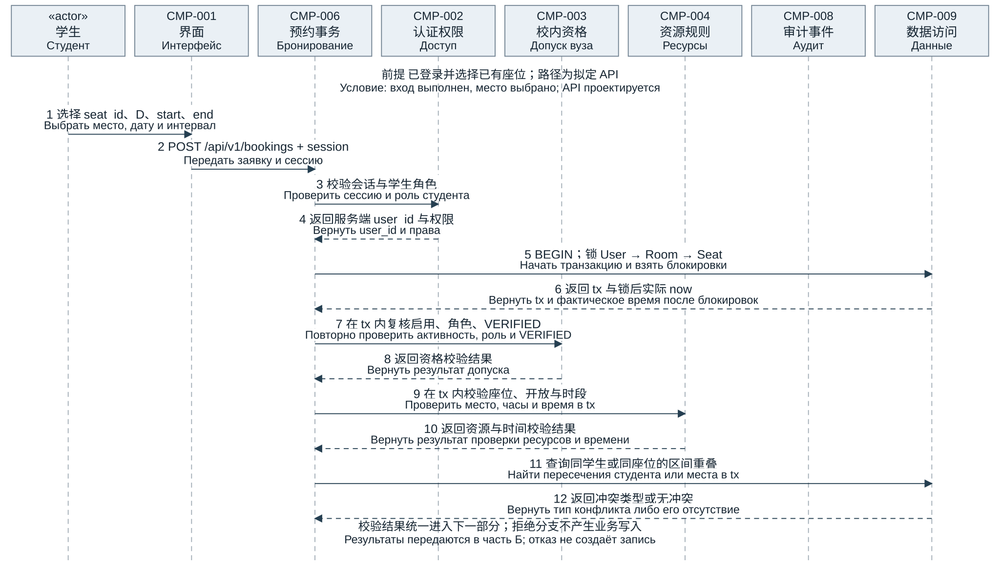
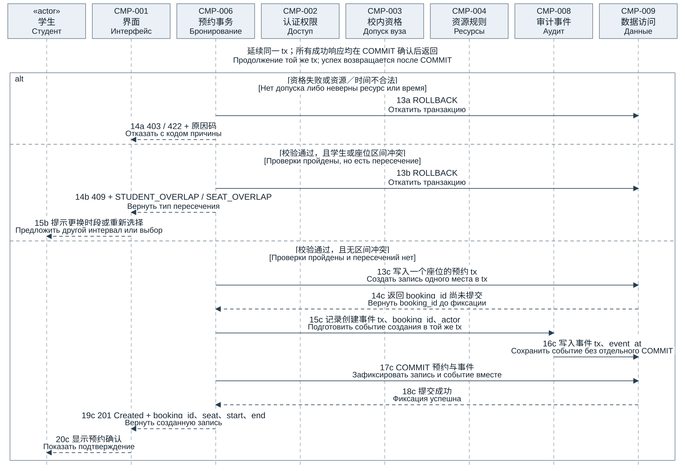
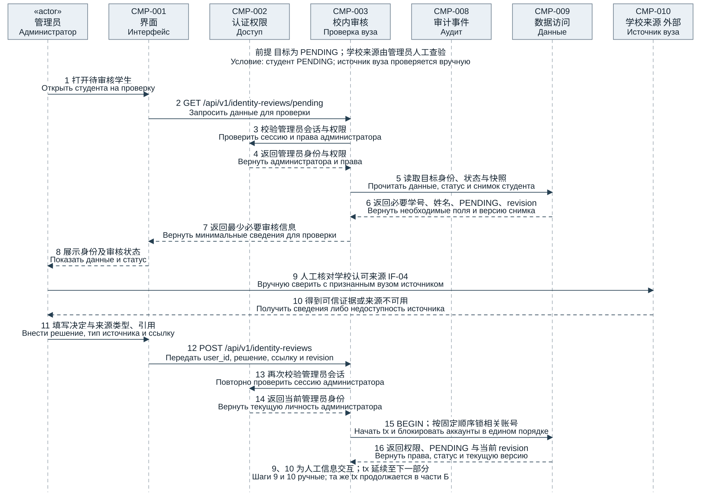
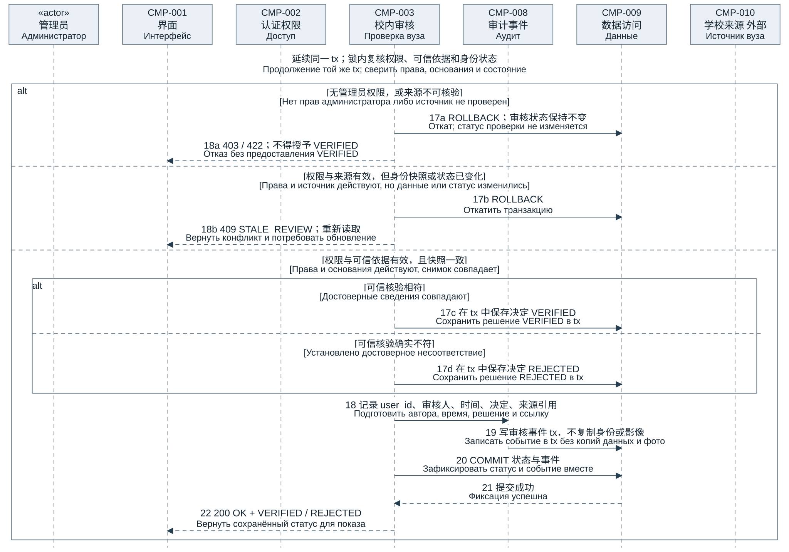

StudySpace 双场景时序图与说明

StudySpace Диаграммы последовательности двух сценариев

本文选择核心预约场景 US-002 和风险审核场景 US-004，给出场景选择表、时序图与流程说明。组件编号沿用 SS-ARCH-03 v2，需求基线为课堂 v0.2 与工程文档 0.3.0。

Выбраны основной сценарий бронирования US-002 и рискованный сценарий проверки US-004. Приведены таблица выбора, диаграммы и пояснения. ID компонентов взяты из SS-ARCH-03 v2; требования из учебной v0.2 и инженерной 0.3.0.

1 两个场景的选择表

1 Таблица выбора двух сценариев

| 用例 Use Case Прецедент | 为什么重要 Почему важен | 参与者 组件与外部系统 Участники компоненты и внешние системы | 用于时序图的替代流程 Альтернативный поток для диаграммы |

| --- | --- | --- | --- |

| US-002 学生创建单座位预约 US-002 Студент бронирует одно место | 主要场景。实现项目的核心价值，并保护同学生与同座位的时段互斥，避免并发重复占用。 Основной сценарий. Реализует цель проекта и исключает пересечения студента и места, включая конкурентные заявки. | 学生；CMP-001 界面；CMP-002 认证；CMP-003 资格；CMP-004 资源；CMP-006 预约；CMP-008 审计；CMP-009 数据。无外部系统。 Студент; CMP-001 интерфейс; CMP-002 доступ; CMP-003 допуск; CMP-004 ресурсы; CMP-006 бронирование; CMP-008 аудит; CMP-009 данные. Внешних систем нет. | 资格或时间规则不通过：403 或 422；同学生或同座位时段冲突：409，回滚且不创建。相邻与多条非重叠预约允许。 Недопуск или неверное время: 403 либо 422. Пересечение студента или места: 409, откат без создания. Соседние и несколько непересекающихся записей допустимы. |

| US-004 管理员审核校内身份 US-004 Администратор проверяет принадлежность к вузу | 风险场景。审核决定预约资格，依赖真实学校证据，并涉及权限、个人信息和审核竞争。 Рискованный сценарий. Решение даёт допуск к бронированию, зависит от реальных сведений вуза и связано с правами, личными данными и гонкой проверок. | 管理员；CMP-001 界面；CMP-002 认证；CMP-003 校内审核；CMP-008 审计；CMP-009 数据；外部 CMP-010 学校核验来源，由管理员人工查询。 Администратор; CMP-001 интерфейс; CMP-002 доступ; CMP-003 проверка; CMP-008 аудит; CMP-009 данные; внешний CMP-010 источник вуза, проверяемый вручную. | 来源无法核实：不授予 VERIFIED，保持 PENDING；可信证据不符：REJECTED；审核期间身份或状态变化：409；管理员无权限：403。 Источник не проверен: без VERIFIED, остаётся PENDING. Достоверные сведения не совпадают: REJECTED. Изменение данных или статуса: 409. Нет прав: 403. |

图中路径、错误码及审核快照 revision 为本文件拟定的设计契约；不代表现有业务接口。业务实现未完成，业务测试保持 NOT_RUN。

Пути API, коды ошибок и revision снимка проверки являются предлагаемыми контрактами. Это не готовые бизнес-интерфейсы; реализация не завершена, бизнес-тесты остаются NOT_RUN.

2 场景一 学生创建单座位预约

2 Сценарий один Бронирование одного места студентом

2.1 目标与前后条件

2.1 Цель и условия

目标是创建一条单座位预约。学生已登录并选中已有座位，但查询结果不保证提交时空闲。服务端重新检查启用状态、STUDENT 角色和 VERIFIED 资格。

Цель — создать запись одного места. Студент вошёл и выбрал место, но поиск не гарантирует доступность при отправке. Сервер повторно проверяет активность, STUDENT и VERIFIED.

预约与创建事件一起提交或回滚。请求含 seat_id、业务日期 D、带时区的 start/end；user_id 从服务端会话取得，不信任客户端自报身份。

Бронирование и событие фиксируются или откатываются вместе. Запрос содержит seat_id, дату D и start/end с часовым поясом; user_id берётся из серверной сессии, а не от клиента.

2.2 主流程与替代流程

2.2 Основной и альтернативные потоки

步骤 1–12：提交、授权、事务加锁，按锁后实际时刻复核资格与资源时间，并查询同学生和同座位的重叠。图 1A、1B 是同一时序图的连续两部分。

Шаги 1–12: заявка, авторизация, блокировки, повторная проверка допуска, ресурсов и времени, поиск пересечений студента и места. Время берётся после блокировок. Рисунки 1А и 1Б продолжают одну диаграмму.

分支 a：资格不符返回 403，资源或时间不合法返回 422。分支 b：校验通过但区间冲突，返回 409 及冲突类型，并回滚。分支 c：全部通过，写预约和审计事件，提交成功后返回 201 与预约编号。所有分支互斥。

Ветка a: нет допуска — 403, неверный ресурс или время — 422. Ветка b: проверки пройдены, но есть пересечение — 409 с типом конфликта и откат. Ветка c: записать бронь и событие, после успешного COMMIT вернуть 201 и ID. Ветки взаимоисключающие.

2.3 关键业务与事务规则

2.3 Правила бронирования и транзакции

预约区间为 [start,end)。同学生或同座位满足 existing.start < new.end 且 new.start < existing.end 即冲突；取消记录不占用。相邻区间允许，同一学生可持有多条非重叠预约，不设置全局未结束预约总量限制。

Интервал — [start,end). Пересечение студента либо места: existing.start < new.end и new.start < existing.end; отменённые записи не занимают время. Соседние интервалы и несколько непересекающихся записей одного студента допустимы; общего лимита незавершённых записей нет.

使用 Asia/Shanghai 业务日，UTC 存储；默认 08:00–22:00、30 分钟粒度，最短 30 分钟、硬上限 24 小时，限今天至今天+6 且不跨所选业务日。默认窗口实际最多 14 小时；start 必须晚于锁后实际 now。

Деловой день — Asia/Shanghai, хранение — UTC. По умолчанию 08:00–22:00 с шагом 30 минут; минимум 30 минут, предел 24 часа, от сегодня до сегодня+6 без выхода за выбранный день. При обычных часах максимум 14 часов; start позже фактического now после блокировок.

PostgreSQL 锁序为 User → Room → Seat；SQLite 使用 BEGIN IMMEDIATE，二者锁机制不同。锁超时属于暂时不可用，未知数据库异常属于服务端错误，不能全部返回 409。并发尚待验证。

PostgreSQL: User → Room → Seat; SQLite: BEGIN IMMEDIATE с иным механизмом блокировки. Тайм-аут — временная недоступность, неизвестный сбой БД — ошибка сервера, а не 409. Конкурентность ещё не проверена.

图 1A US-002 提交与事务内校验

Рисунок 1А US-002 Отправка и проверки в транзакции

图 1B US-002 条件分支与提交

Рисунок 1Б US-002 Ветвление и фиксация

3 场景二 管理员审核校内身份

3 Сценарий два Проверка принадлежности к вузу

3.1 目标与前后条件

3.1 Цель и условия

管理员依据学校认可的可信来源，审核 PENDING 学生。须有有效管理权限；CMP-010 是人工核验依赖，不假设已有 SSO 或自动学校 API。

Администратор с действующими правами проверяет студента PENDING по признанному вузом источнику. CMP-010 — ручная проверка без предположения о готовом SSO или API вуза.

真实核验相符为 VERIFIED，确实不符为 REJECTED；无法取得可信来源时保持 PENDING。实际来源仍由 OPEN-003 确认，不能声称已完成真实学校核验。

Достоверное совпадение даёт VERIFIED, несоответствие — REJECTED; без проверяемого источника сохраняется PENDING. Реальный источник уточняется в OPEN-003, фактическая проверка вуза не заявляется.

3.2 主流程与替代流程

3.2 Основной и альтернативные потоки

步骤 1–12：授权后显示必要身份与状态，管理员人工核对 CMP-010，提交审核决定、来源类型及引用、快照版本。图 2A、2B 连续展示同一场景。

Шаги 1–12: авторизовать чтение, показать необходимые сведения, вручную сверить CMP-010 и отправить решение, тип и ссылку источника с revision снимка. Рисунки 2А и 2Б продолжают один сценарий.

步骤 13–22：保存时再次授权，在事务与固定锁序下复核管理员、目标账号状态和身份快照。无权限返回 403；来源无法核实返回 422；身份或状态已变化返回 409 并要求刷新。其余情况按相符或不符保存决定和审核事件，提交后返回 200。

Шаги 13–22: повторно авторизовать сохранение и в транзакции с единым порядком блокировок сверить администратора, аккаунт и снимок. Нет прав — 403; источник не проверен — 422; данные или статус изменились — 409 с обновлением. Иначе по результату сверки сохранить решение и событие, после COMMIT вернуть 200.

3.3 数据保护与边界

3.3 Данные и границы

User 保留必要学号、姓名及当前状态；审核事件仅含 user_id、审核人、event_at、决定、来源类型与引用，不复制原始学号、姓名或证明影像。状态与事件共用同一事务。

User хранит необходимые номер, имя и статус; событие — user_id, автора, event_at, решение, тип и ссылку источника без копий номера, имени или изображений. Статус и событие используют одну транзакцию.

revision 是本次拟定的身份与状态快照契约，实现机制待开发。身份变更、停用及其取消预约联动是其他场景，沿用既有规则。

revision — предлагаемый контракт снимка идентификаторов и статуса; реализация определяется при разработке. Их изменение, отключение и отмена записей — другие сценарии по прежним правилам.

PENDING 仅可登录只读；启用且 VERIFIED 的 STUDENT 可预约；REJECTED 可申请复核。学生后续读取自身状态查看结果，不增加自动通知。

PENDING даёт только чтение; активный STUDENT с VERIFIED бронирует; после REJECTED возможна повторная заявка. Результат читается в статусе студента без автоматического уведомления.

图 2A US-004 人工核验与事务复核

Рисунок 2А US-004 Ручная сверка и повторные проверки

图 2B US-004 条件分支与审核提交

Рисунок 2Б US-004 Ветвление и сохранение проверки

4 参与组件与课堂要求核对

4 Компоненты и сверка с заданием

4.1 与既有组件图的对应

4.1 Соответствие диаграмме компонентов

| 编号 ID | 组件名称 Компонент | 使用场景 Сценарий |

| --- | --- | --- |

| CMP-001 CMP-001 | 学生与管理员界面 Интерфейс студента и администратора | 场景一、场景二 Оба сценария |

| CMP-002 CMP-002 | 账号认证与权限控制 Аутентификация и права доступа | 场景一、场景二 Оба сценария |

| CMP-003 CMP-003 | 校内身份审核与预约资格 Проверка принадлежности к вузу и допуск | 场景一、场景二 Оба сценария |

| CMP-004 CMP-004 | 房间座位与开放规则管理 Помещения места и правила работы | 场景一 Сценарий один |

| CMP-006 CMP-006 | 预约事务与冲突控制 Транзакции бронирования и конфликты | 场景一 Сценарий один |

| CMP-008 CMP-008 | 审计与数据生命周期 Аудит и жизненный цикл данных | 场景一、场景二 Оба сценария |

| CMP-009 CMP-009 | 数据访问与持久化 Доступ к данным и хранение | 场景一、场景二 Оба сценария |

| CMP-010 CMP-010 | 可信学校核验来源 Доверенный источник вуза | 场景二 外部人工依赖 Сценарий два Внешняя ручная зависимость |

CMP-005 可用性查询发生于场景一的前置选择阶段；CMP-007 记录统计不在这两个交互范围内，故未新增生命线。学生与管理员是角色，不新增组件。CMP-009 包含持久化访问，未再增设独立“数据库组件”。

CMP-005 используется при предварительном выборе; CMP-007 со статистикой вне этих взаимодействий, поэтому отдельные линии не добавлены. Студент и администратор — акторы. CMP-009 представляет доступ к хранению без нового компонента БД.

4.2 表达方式与一致性

4.2 Обозначения и согласованность

实线箭头表示调用或提交，虚线箭头表示返回，竖虚线为生命线。alt 条件互斥，每次仅执行一个满足条件的分支。两图均无需 opt 或 loop；不增加提醒或循环。内部空返回可省略。

Сплошная стрелка — вызов или отправка, пунктирная — возврат, вертикальный пунктир — линия жизни. Условия alt взаимоисключающие, выполняется одна подходящая ветка. Здесь opt и loop не нужны; пустые внутренние возвраты могут опускаться.

界面通过候选 HTTPS/JSON API 调用后端；CMP-002 至 CMP-009 的交互是 FastAPI 模块化单体内部调用，不表示独立微服务。图中的事务、锁、规则检查及接口均是设计内容。

Интерфейс вызывает сервер через предлагаемый HTTPS/JSON API; взаимодействия CMP-002–CMP-009 — внутренние вызовы модульного монолита FastAPI, а не микросервисы. Транзакции, блокировки, проверки и API на схемах являются проектом.

5 追溯与计划验证

5 Трассируемость и план проверки

| 场景 Сценарий | 主要需求与决定 Требования и решения | 既有计划测试 Плановые тесты |

| --- | --- | --- |

| US-002 US-002 | SP-FR-007、SP-FR-008、SP-FR-009；SP-NFR-004；DEC-016 SP-FR-007, SP-FR-008, SP-FR-009; SP-NFR-004; DEC-016 | TC-007、TC-008、TC-017、TC-025、TC-030、TC-031、TC-032、TC-033 TC-007, TC-008, TC-017, TC-025, TC-030, TC-031, TC-032, TC-033 |

| US-004 US-004 | SP-FR-004、SP-FR-022；SP-IF-002；SP-DR-001；OPEN-003 SP-FR-004, SP-FR-022; SP-IF-002; SP-DR-001; OPEN-003 | TC-001、TC-003、TC-015、TC-035、TC-038 TC-001, TC-003, TC-015, TC-035, TC-038 |

两场景的业务测试均为 NOT_RUN。计划验证预约正常创建、同学生／同座位重叠、相邻与非重叠多预约、并发与事务回滚；审核验证可信通过、不符拒绝、来源缺失、权限失效和审核期间数据变化。

Бизнес-тесты обоих сценариев имеют статус NOT_RUN. Планируются создание, пересечения студента и места, соседние и непересекающиеся записи, конкуренция и откат; для проверки — достоверный успех, отказ, отсутствие источника, утрата прав и изменение данных.

课程内容检查包括恰好两个用例、四列表格、统一组件编号、标注消息及响应、明确 alt 条件，以及中俄上下对应。文档结构和页面检查不等于业务运行验证或教师验收。

Проверка материала включает два Use Case, четыре колонки, единые ID компонентов, подписи сообщений и ответов, условия alt и пары китайского и русского текста. Проверка документа и страниц не является запуском бизнеса или приёмкой преподавателя.

6 依据与交付信息

6 Основания и сведения о результате

课堂依据为本次四张图片：元素与片段提示、预约示例、从场景到时序图的步骤、两个场景的选择表。最终选择表保留原四列和两条场景记录。

Учебные основания — четыре фото: элементы и фрагменты, пример бронирования, переход от сценария к диаграмме и таблица выбора двух сценариев. Итоговая таблица сохраняет четыре колонки и две записи.

项目依据为 SS-ARCH-03 v2 统一组件表与组件图、DOC-04 系统设计 0.3.0、课堂需求登记 v0.2、用户故事待办 SS-PB-05 v1、project-decisions.json 中的 DEC-016。OPEN-003 的真实来源仍待确认。

Основания проекта: единые компоненты и схема SS-ARCH-03 v2, DOC-04 0.3.0, учебный реестр v0.2, бэклог SS-PB-05 v1 и DEC-016 в project-decisions.json. Реальный источник OPEN-003 остаётся неуточнённым.

执行环境为本地 macOS 与 Codex 内置 Python、文档渲染工具；本次仅新增课程设计材料。可编辑 draw.io 文件含 US-002 与 US-004 两个页签，每个页签保留前后两部分。

Среда — локальная macOS, встроенные Python и средства рендеринга Codex. Добавлен учебный проектный материал. Редактируемый файл draw.io содержит вкладки US-002 и US-004 с обеими частями каждого сценария.

交付目录

Каталог результата

