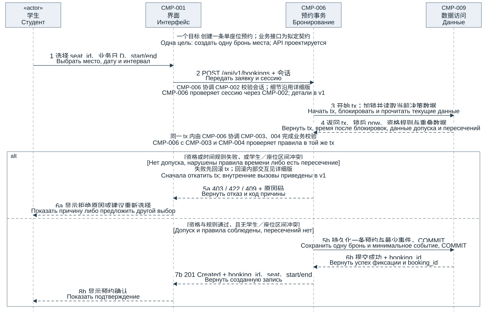
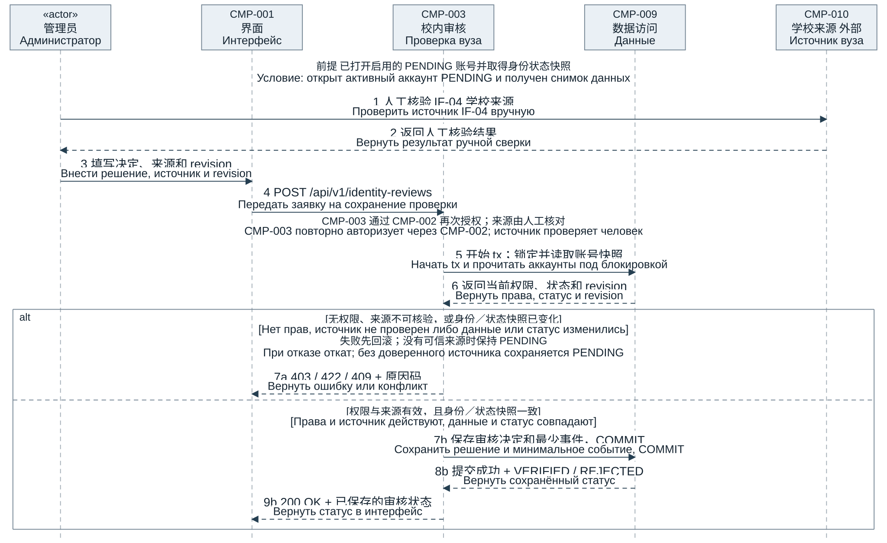

StudySpace 时序图检查与精简版

StudySpace Проверка и краткие диаграммы последовательности

本版按课件六项标准核查并精简 US-002、US-004，每图均为 10 条可见消息。此前 v1 分别为 25 条与 27 条，不符合本次新增的数量限制，保留作实现细节参考。

По шести критериям проверены и сокращены US-002 и US-004: в каждой схеме 10 видимых сообщений. Подробная v1 с 25 и 27 сообщениями не отвечает новому лимиту и сохранена для деталей реализации.

1 六项课堂检查结果

1 Результаты шести проверок

| 课堂检查项 Критерий слайда | StudySpace 核对内容与证据 Сверка и свидетельства StudySpace | 结果 Итог |

| --- | --- | --- |

| 1 参与者与 3.3.1 组件及外部系统一致 Участники совпадают с компонентами и внешними системами диаграммы 3.3.1 | 图 1 使用学生、CMP-001、006、009；图 2 使用管理员、CMP-001、003、009 和外部 CMP-010。均来自既有组件基线。 Рис. 1: студент, CMP-001, 006, 009. Рис. 2: администратор, CMP-001, 003, 009 и внешний CMP-010. Все ID из прежней схемы. | 通过 Пройдено |

| 2 每条消息有名称和清晰方向 Каждое сообщение имеет подпись и понятное направление | 每条箭头标注编号、操作和中俄文字；六列消息表逐条记录发送方、接收方、数据和结果。 Все стрелки имеют номер, операцию и две подписи; таблицы задают отправителя, получателя, данные и результат. | 通过 Пройдено |

| 3 至少一个替代流程 Показан хотя бы один альтернативный поток (ошибка данных, нет прав или недоступность) | 两图均有 alt。预约覆盖资格、非法时间和重叠；审核覆盖权限、来源不可核验与过期快照。 В обеих схемах alt. Бронь: недопуск, неверное время, пересечение. Проверка: нет прав, источник не проверен, снимок устарел. | 通过 Пройдено |

| 4 有返回码或结果 Есть ответы с кодами или результатами | 预约返回 201 或 403/422/409；审核返回 200 或 403/422/409。对用户的成功响应在提交确认后返回。 Бронь: 201 либо 403/422/409. Проверка: 200 либо 403/422/409. Успех операции пользователю возвращается после COMMIT. | 通过 Пройдено |

| 5 与用例及验收标准一致 Сценарий согласован с описанием Use Case и критериями приёмки | 沿用 US-002、US-004 及其正常、异常和并发边界；第 4 节核对验收标准，第 5 节列出需求和计划测试。 Сохранены US-002, US-004 и их границы; раздел 4 сверяет приёмку, раздел 5 указывает требования и плановые тесты. | 通过 Пройдено |

| 6 一个目标且 6–10 条消息 Диаграмма не перегружена: одна цель, 6–10 сообщений | 每图总计 10 条箭头，包含全部分支及返回。预约正常 8／拒绝 6；审核正常 9／拒绝 7。 В каждой схеме 10 стрелок со всеми ветками и возвратами. Бронь: успех 8, отказ 6; проверка: успех 9, отказ 7. | 通过 Пройдено |

通过仅指本版设计材料的核对；业务测试保持 NOT_RUN，教师验收尚未执行。计数包含全部分支的调用与返回箭头。

Пройдено означает сверку проектного материала. Бизнес-тесты NOT_RUN, приёмка преподавателя не выполнена. Подсчёт включает вызовы и возвраты всех веток.

图 1 US-002 创建单座位预约 共 10 条消息

Рисунок 1 US-002 Создание одной брони 10 сообщений

2 图 1 配套消息表

2 Таблица сообщений рисунка 1

| 序号 № | 发送方 От | 接收方 Кому | 操作或消息 Операция / сообщение | 数据 Данные | 响应或结果 Ответ / результат |

| --- | --- | --- | --- | --- | --- |

| 1 | 学生 Студент | CMP-001 界面 Интерфейс | 选择 seat_id、业务日 D、start/end Выбрать место, дату и интервал | seat_id；D；start/end seat_id, D, start/end | 界面取得单座位与时段 Принят выбор места и времени |

| 2 | CMP-001 界面 Интерфейс | CMP-006 预约 Бронирование | POST /api/v1/bookings + 会话 Передать заявку и сессию | 会话；seat_id；D；带时区时刻 Сессия, место, дата, время с часовым поясом | 发起创建；user_id 取自会话 Создание; user_id берётся из сессии |

| 3 | CMP-006 预约 Бронирование | CMP-009 数据 Данные | 开始 tx；加锁并读取当前决策数据 Начать tx, блокировать и прочитать текущие данные | tx；user_id；room_id；seat_id tx, user_id, room_id, seat_id | 按既有锁序读取一致数据 Прочитать согласованные данные под блокировками |

| 4 | CMP-009 数据 Данные | CMP-006 预约 Бронирование | 返回 tx、锁后 now、资格规则与重叠数据 Вернуть tx, время после блокировок, данные допуска и пересечений | tx；锁后 now；状态、规则和重叠数据 tx; now после блокировок; статус, правила, пересечения | 业务组件在同一 tx 内作出校验决定 Бизнес-компонент проверяет правила в той же tx |

| 5a | CMP-006 预约 Бронирование | CMP-001 界面 Интерфейс | 403 / 422 / 409 + 原因码 Вернуть отказ и код причины | 403：资格；422：资源时间；409：重叠 403: допуск; 422: ресурс/время; 409: пересечение | 先回滚，不创建预约 Сначала откат, без создания |

| 6a | CMP-001 界面 Интерфейс | 学生 Студент | 显示拒绝原因或建议重新选择 Показать причину либо предложить другой выбор | 原因码；重新选择提示 Код причины; предложение другого выбора | 学生可改时段后再查询 Студент может выбрать другое время |

| 5b | CMP-006 预约 Бронирование | CMP-009 数据 Данные | 持久化一条预约与最少事件，COMMIT Сохранить одну бронь и минимальное событие, COMMIT | tx；一个座位的预约；最少事件 tx; бронь одного места; минимальное событие | 预约与事件原子提交 Бронь и событие фиксируются вместе |

| 6b | CMP-009 数据 Данные | CMP-006 预约 Бронирование | 提交成功 + booking_id Вернуть успех фиксации и booking_id | 提交结果；booking_id Результат COMMIT, booking_id | 提交已确认，才允许响应成功 Фиксация подтверждена, успех допустим |

| 7b | CMP-006 预约 Бронирование | CMP-001 界面 Интерфейс | 201 Created + booking_id、seat、start/end Вернуть созданную запись | HTTP 201；编号、座位、起止时刻 HTTP 201; ID, место, начало/конец | 界面取得已保存预约 Интерфейс получает сохранённую бронь |

| 8b | CMP-001 界面 Интерфейс | 学生 Студент | 显示预约确认 Показать подтверждение | 预约编号与确认时段 ID брони и подтверждённый интервал | 学生看到预约确认 Студент видит подтверждение |

图 2 US-004 校内身份审核 共 10 条消息

Рисунок 2 US-004 Проверка вуза 10 сообщений

3 图 2 配套消息表

3 Таблица сообщений рисунка 2

| 序号 № | 发送方 От | 接收方 Кому | 操作或消息 Операция / сообщение | 数据 Данные | 响应或结果 Ответ / результат |

| --- | --- | --- | --- | --- | --- |

| 1 | 管理员 Администратор | CMP-010 来源 Источник вуза | 人工核验 IF-04 学校来源 Проверить источник IF-04 вручную | 必要学号、姓名；认可渠道 Номер, имя; признанный канал | 人工核验；OPEN-003 待确认 Ручная сверка; OPEN-003 открыт |

| 2 | CMP-010 来源 Источник вуза | 管理员 Администратор | 返回人工核验结果 Вернуть результат ручной сверки | 核验结论；来源引用 Итог сверки и ссылка | 无法核验不得批准 VERIFIED Без проверки VERIFIED запрещён |

| 3 | 管理员 Администратор | CMP-001 界面 Интерфейс | 填写决定、来源和 revision Внести решение, источник и revision | user_id；decision；source_type/ref；revision ID, решение, источник, revision | 界面整理申请 Интерфейс формирует заявку |

| 4 | CMP-001 界面 Интерфейс | CMP-003 审核 Проверка вуза | POST /api/v1/identity-reviews Передать заявку на сохранение проверки | 会话；步骤 3 的审核申请 Сессия и заявка из шага 3 | 服务端重新授权并检查 Сервер повторно авторизует и проверяет |

| 5 | CMP-003 审核 Проверка вуза | CMP-009 数据 Данные | 开始 tx；锁定并读取账号快照 Начать tx и прочитать аккаунты под блокировкой | tx；相关账号与固定锁序 tx; аккаунты, порядок блокировок | 读取锁内当前状态 Прочитать данные под блокировками |

| 6 | CMP-009 数据 Данные | CMP-003 审核 Проверка вуза | 返回当前权限、状态和 revision Вернуть права, статус и revision | 当前权限、状态、revision Права, статус, revision | 比对原身份与状态快照 Сверить с исходным снимком |

| 7a | CMP-003 审核 Проверка вуза | CMP-001 界面 Интерфейс | 403 / 422 / 409 + 原因码 Вернуть ошибку или конфликт | 403：权限；422：来源；409：快照变化 403: права; 422: источник; 409: изменённый снимок | 回滚；无来源保持 PENDING Откат; без источника остаётся PENDING |

| 7b | CMP-003 审核 Проверка вуза | CMP-009 数据 Данные | 保存审核决定和最少事件，COMMIT Сохранить решение и минимальное событие, COMMIT | tx；决定、审核人、时间及来源引用 tx; решение, автор, время и ссылка | 相符→VERIFIED；真实不符→REJECTED Совпадение: VERIFIED; несоответствие: REJECTED |

| 8b | CMP-009 数据 Данные | CMP-003 审核 Проверка вуза | 提交成功 + VERIFIED / REJECTED Вернуть сохранённый статус | 提交结果；VERIFIED 或 REJECTED COMMIT; VERIFIED либо REJECTED | 状态与事件原子提交 Общая фиксация статуса и события |

| 9b | CMP-003 审核 Проверка вуза | CMP-001 界面 Интерфейс | 200 OK + 已保存的审核状态 Вернуть статус в интерфейс | HTTP 200；审核状态 HTTP 200; статус проверки | 显示已保存结果 Показать сохранённый итог |

4 用例与验收标准核对

4 Сверка Use Case и критериев приёмки

4.1 US-002 创建单座位预约

4.1 US-002 Создание одной брони

目标是创建一条预约；前提是学生已登录、已选择已有座位，系统仍在服务端复核会话、启用状态和 VERIFIED。查询结果不保证提交时空闲，user_id 从会话取得。成功仅在预约与创建事件一起提交后返回 201。

Цель — одна бронь. Студент вошёл и выбрал существующее место; сервер повторно проверяет сессию, активность и VERIFIED. Поиск не гарантирует доступность при отправке; user_id берётся из сессии. Ответ 201 возможен после общего COMMIT записи и события.

对应既有验收标准：合法申请只创建一条并返回 ID；未核验、同学生或同座位重叠均拒绝；[start,end) 边界相邻及多条非重叠预约允许。校验失败回滚，不能把查询后再写入当作并发保证。

Прежняя приёмка: допустимая заявка создаёт одну запись с ID; недопуск и пересечения студента либо места запрещены. Для [start,end) соседние и несколько непересекающихся записей разрешены. Отказ требует отката; обычные поиск и запись не доказывают конкурентную корректность.

时间仍按 Asia/Shanghai 业务日、UTC 存储，默认 08:00–22:00、30 分钟粒度，今天至今天+6，不跨所选业务日，时长硬上限 24 小时且默认窗口最多 14 小时。起点严格晚于锁后实际 now；PostgreSQL 锁序 User → Room → Seat，SQLite 使用 BEGIN IMMEDIATE。

День Asia/Shanghai, хранение UTC; по умолчанию 08:00–22:00, шаг 30 минут, от сегодня до сегодня+6 без выхода за день. Предел 24 часа, при обычных часах 14. Начало позже фактического now после блокировок; PostgreSQL: User → Room → Seat, SQLite: BEGIN IMMEDIATE.

4.2 US-004 校内身份审核

4.2 US-004 Проверка принадлежности к вузу

目标是保存一项人工审核决定。图从管理员已打开启用的 PENDING 账号并取得身份状态快照开始；读取待审核列表是前置步骤。CMP-010 为外部人工核验来源，具体来源仍由 OPEN-003 确认，不假设已有自动 API。

Цель — сохранить одно решение ручной проверки. В начале открыт активный аккаунт PENDING и получен снимок; загрузка списка является предварительным шагом. CMP-010 — внешний источник ручной сверки, реальный канал в OPEN-003, без готового автоматического API.

对应既有验收标准：可信来源与身份相符才可保存 VERIFIED；真实核验不符保存 REJECTED；无可信来源不批准，保持 PENDING。保存时重新授权并比较锁内快照；身份变更或停用竞争导致快照失效时回滚，不能取得预约资格。

Прежняя приёмка: достоверное совпадение позволяет VERIFIED, несоответствие — REJECTED; без источника остаётся PENDING. При сохранении повторно авторизовать и сравнить снимок под блокировкой. Изменение идентификаторов или отключение делает снимок устаревшим: откат без допуска.

状态与审核事件一起提交。事件仅含 user_id、审核人、event_at、决定和来源类型引用，不复制原始学号、姓名或证明影像。REJECTED 可申请复核；只有启用且 VERIFIED 的 STUDENT 能预约。

Статус и событие фиксируются вместе. Событие содержит user_id, автора, event_at, решение, тип и ссылку источника без копий номера, имени или изображений. После REJECTED возможна повторная заявка; бронирует только активный STUDENT с VERIFIED.

5 抽象层次与追溯说明

5 Уровень детализации и трассируемость

图 1 的业务控制仍由 CMP-006 承担；CMP-009 只承担锁、数据读取、持久化与事务支持。CMP-002 认证、CMP-003 资格、CMP-004 资源和 CMP-008 最少审计事件属于未展开的内部协作，不转移给数据访问组件。

На рисунке 1 бизнес-решения остаются у CMP-006; CMP-009 отвечает за блокировки, данные, хранение и транзакцию. Аутентификация CMP-002, допуск CMP-003, ресурсы CMP-004 и минимальный аудит CMP-008 — нераскрытые внутренние вызовы, не переданные слою данных.

图 2 保留管理员与 CMP-010 的人工信息交互。CMP-003 负责审核决定，CMP-002 再次授权、CMP-008 准备最少事件的内部细节沿用 v1。两图的合并保存调用表示同一事务的工作单元，成功返回必须晚于 COMMIT 确认。

Рисунок 2 сохраняет ручной обмен администратора с CMP-010. Решение принимает CMP-003, повторная авторизация CMP-002 и минимальное событие CMP-008 раскрыты в v1. Объединённое сохранение означает работу одной транзакции; успех следует после подтверждения COMMIT.

本版合并相同保存路径的不同决定参数：相符为 VERIFIED，真实不符为 REJECTED；失败分支按原因分别返回 403、422 或 409。锁超时和未知数据库异常仍须回滚并按实际错误处理，不一律归为 409。

Одинаковый путь сохранения объединяет параметры VERIFIED при совпадении и REJECTED при достоверном несоответствии. Отказ возвращает 403, 422 либо 409 по причине. Тайм-аут и неизвестные сбои БД требуют отката и отдельной обработки, а не всегда 409.

| 用例 Сценарий | 需求与规则 Требования и правила | 计划测试 Плановые тесты |

| --- | --- | --- |

| US-002 US-002 | SP-FR-008、SP-FR-009、SP-NFR-004；DEC-016 SP-FR-008, SP-FR-009, SP-NFR-004; DEC-016 | TC-007、TC-008、TC-017、TC-025、TC-031、TC-033 TC-007, TC-008, TC-017, TC-025, TC-031, TC-033 |

| US-004 US-004 | SP-FR-022、SP-IF-002、SP-DR-001；OPEN-003 SP-FR-022, SP-IF-002, SP-DR-001; OPEN-003 | TC-015、TC-035、TC-038 TC-015, TC-035, TC-038 |

图和表均为 DRAFT 设计。API 路径、错误码与审核 revision 是拟定契约；内部调用仍在 FastAPI 模块化单体内。业务实现未完成，业务测试 NOT_RUN，材料结构和视觉检查不替代教师验收。

Диаграммы и таблицы — проект DRAFT. Пути API, коды и revision являются предлагаемыми контрактами; внутренние вызовы остаются в модульном монолите FastAPI. Реализация не завершена, тесты NOT_RUN; проверка материала не заменяет приёмку преподавателя.

依据为本次六项检查课件、既有 SS-SEQ-01 v1 图与任务三消息表、SS-ARCH-03 v2 组件基线、DOC-04 0.3.0、课堂需求登记 v0.2 与 DEC-016。本次新增 v2，原详细版及业务需求文件保持不变。

Основания: слайд шести проверок, схемы SS-SEQ-01 v1 и таблицы задания 3, компоненты SS-ARCH-03 v2, DOC-04 0.3.0, учебный реестр v0.2 и DEC-016. Добавлена v2 без изменения подробной версии и требований.

交付位置为 studyspace/coursework/2026-10-15-sequence-review-v2。执行环境为本地 macOS、Codex 内置 Python 与文档渲染工具；可编辑 draw.io 含两个场景页签。

Каталог: studyspace/coursework/2026-10-15-sequence-review-v2. Среда: локальная macOS, встроенные Python и рендеринг Codex; редактируемый draw.io содержит две вкладки.

