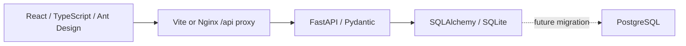

# StudySpace

**Web教室与自习室预约管理系统**  
**Система бронирования учебных аудиторий и мест для самостоятельной работы**

App: **0.1.0** · Requirements: **0.3.0** · API draft: **0.1.0** · Updated: **2026-10-16** · Stage: **REQUIREMENTS CLARIFICATION / УТОЧНЕНИЕ ТРЕБОВАНИЙ**

## 1. 项目与边界 / Проект и границы

中文：面向大学生和学校管理人员的大学软件工程课程项目。MVP查询和管理教室、自习室内的单个座位并预约，预约前必须验证校内身份。现有骨架提供中文、俄语、英语首页、真实API连接状态、健康/数据库就绪检查和基础测试。认证、校内审核、资源管理和预约业务尚未实现；业务输入已根据用户答复及授权澄清，完整SRS仍为 IEEE Std 830-1998 结构的DRAFT，38条需求仍PROPOSED，不声称老师已批准。

Русский: Учебный проект для студентов и сотрудников университета. MVP ищет, управляет и бронирует отдельные места в учебных помещениях; принадлежность к вузу проверяется до бронирования. Каркас содержит китайскую, русскую и английскую страницы, реальное соединение API, проверки работоспособности/готовности БД и базовые тесты. Аутентификация, проверка вуза, ресурсы и бронирование не реализованы. Входные правила уточнены по ответам и делегированию; вся SRS по IEEE Std 830-1998 остаётся DRAFT,38 требований PROPOSED, утверждение преподавателем не заявляется.

中文：课程主角色按图片及此前名单顺序：支浩然（分析员/技术任务书作者）、俞智文（文档编辑）、曹浩然（测试员）、吕嘉伟（项目经理）。允许按主题轮换并记录交接，开发全员协作。默认Asia/Shanghai、每天08:00–22:00、30分钟粒度、最长24小时（默认窗口实际14小时）；同学生预约时段不得重叠，非重叠时段允许多条，含同日及不同未来日；每条仍仅1seat。详见 [需求澄清](docs/zh-CN/16_Requirements_Clarification.md)。

Русский: По изображению и порядку списка: 支浩然 аналитик/авторТЗ,俞智文 редактор,曹浩然 тестировщик,吕嘉伟 менеджер. Роли сменяются по темам с передачей, разработка совместная. Asia/Shanghai,08:00–22:00,30мин,24ч (обычно14ч); интервалы студента не пересекаются, несколько непересекающихся одного/разных будущих дней допустимы, одна запись одноseat. [Уточнение](docs/ru-RU/16_Requirements_Clarification.md).

## 2. 技术架构 / Техническая архитектура

中文：前后端分离、模块化单体。React + TypeScript + Vite + Ant Design前端通过 `/api/v1` HTTP/JSON访问FastAPI；后端使用Pydantic校验与同步SQLAlchemy，开发数据库为SQLite。Vite开发代理与Nginx容器代理统一转发 `/api`。数据库连接字符串可替换，`postgres`可选依赖预留PostgreSQL驱动；迁移脚本、真实PostgreSQL兼容测试和预约并发约束留待后续实施。依赖由 `frontend/package-lock.json` 和 `backend/uv.lock` 固定。

Русский: Раздельные фронтенд и бэкенд, модульный монолит. React + TypeScript + Vite + Ant Design обращается к FastAPI через HTTP/JSON в `/api/v1`; бэкенд использует Pydantic и синхронный SQLAlchemy, при разработке — SQLite. Прокси Vite и контейнерный Nginx направляют `/api` на бэкенд. Строка подключения настраивается; дополнительная зависимость `postgres` предусматривает драйвер PostgreSQL. Скрипты миграции, реальные проверки совместимости PostgreSQL и ограничения конкурентного бронирования ещё предстоит реализовать. Зависимости фиксируются в `frontend/package-lock.json` и `backend/uv.lock`.



## 3. 安装与本地启动 / Установка и локальный запуск

中文：建议Node.js 22.13+（22.x，或24+）、npm、Python 3.13、uv、Git。Docker Compose可选。先检查工具；初始化实测环境和结果见双语报告。命令均在项目根目录执行，脚本首次复制 `.env.example` 到 `.env`，已有 `.env` 不会覆盖。项目依赖安装到本项目的虚拟环境和node_modules；工具下载缓存按各自配置写入，首次下载需要网络。

Русский: Рекомендуются Node.js 22.13+ (ветка 22.x, либо 24+), npm, Python 3.13, uv и Git. Docker Compose необязателен. Сначала проверьте инструменты; фактическая среда и результаты приведены в парном отчёте. Все команды выполняются из корня проекта. При первой установке `.env.example` копируется в `.env`; существующий `.env` сохраняется. Зависимости устанавливаются в виртуальную среду и node_modules проекта; кэш загрузок хранится согласно настройкам инструментов, для первой загрузки нужен интернет.

```bash
cd "/Users/zhi/Documents/软件生命周期/studyspace"
node --version
npm --version
uv --version
git --version
bash scripts/setup.sh
bash scripts/dev.sh
```

中文：首页 [http://127.0.0.1:5173](http://127.0.0.1:5173)，API文档 [http://127.0.0.1:8000/api/v1/docs](http://127.0.0.1:8000/api/v1/docs)。`Ctrl+C`停止两个服务。端口被占用时脚本拒绝启动；不要结束不属于本项目的进程。需要指定已安装Python时，使用 `STUDYSPACE_PYTHON=/path/to/python3.13 bash scripts/setup.sh`。uv缓存默认按工具配置；受限环境可设 `UV_CACHE_DIR=/private/tmp/studyspace-uv-cache` 和 `npm_config_cache=/private/tmp/studyspace-npm-cache`。

Русский: Страница — [http://127.0.0.1:5173](http://127.0.0.1:5173), документация API — [http://127.0.0.1:8000/api/v1/docs](http://127.0.0.1:8000/api/v1/docs). `Ctrl+C` останавливает оба сервиса. При занятом порте скрипт отказывается запускаться; не завершайте чужие процессы. Для выбора установленного Python используйте `STUDYSPACE_PYTHON=/path/to/python3.13 bash scripts/setup.sh`. Для ограниченной среды можно задать `UV_CACHE_DIR=/private/tmp/studyspace-uv-cache` и `npm_config_cache=/private/tmp/studyspace-npm-cache`.

## 4. 验证与可选容器 / Проверка и необязательные контейнеры

```bash
bash scripts/check.sh
python3 scripts/check_docs.py
python3 scripts/generate_registers.py --check
backend/.venv/bin/python scripts/check_api_contract.py
docker compose config --quiet
# Docker Desktop must be running / 需启动Docker / Docker должен быть запущен
docker compose up --build
```

中文：容器首页为 `http://127.0.0.1:8080`。本地开发和容器后端共用8000端口，运行Compose前停止开发服务。`docker compose down` 停止容器；不要使用 `down -v` 删除数据库卷。Compose配置验证不等于镜像构建或部署通过。当前Docker守护进程未运行，容器构建/启动尚未验证。基础测试通过也不等于业务验收；业务TC保持 NOT_RUN。

Русский: Страница контейнера — `http://127.0.0.1:8080`. Локальный и контейнерный бэкенд используют порт 8000; перед Compose остановите разработку. `docker compose down` останавливает контейнеры; не используйте `down -v`, удаляющий том БД. Проверка конфигурации Compose не подтверждает сборку или развёртывание. При инициализации Docker-демон не запущен; сборка/запуск контейнеров не проверены. Успешные базовые тесты не означают приёмку бизнес-функций; бизнес-кейсы остаются NOT_RUN.

## 5. 文档与协作 / Документы и совместная работа

中文：正式文档入口 [docs/README.md](docs/README.md)，课程交付入口 [coursework/README.md](coursework/README.md)。21对正式文档在 `docs/zh-CN/`、`docs/ru-RU/`和双语ADR目录；需求、计划测试、用户决定的结构化来源在 `docs/data/`。长期规则见 [AGENTS.md](AGENTS.md)，4人8周计划见 `11_Development_Plan.md`。12项OPEN设计问题已关闭；仅学校真实核验来源、课程具体条件、部署机位/域名三组事项PARTIAL。历史及本轮证据见 [初始化报告](docs/zh-CN/15_Initialization_Report.md) 和 [源文件清单](docs/file-inventory.txt)。

Русский: Официальные документы — [docs/README.md](docs/README.md), учебные материалы — [coursework/README.md](coursework/README.md). 21 пара в `docs/zh-CN/`, `docs/ru-RU/` и парном ADR-каталоге. Источники требований, плановых тестов и решений — `docs/data/`; правила — [AGENTS.md](AGENTS.md), план четырёх участников на8 недель — `11_Development_Plan.md`.12 проектных вопросов закрыты; PARTIAL остаются реальный источник вуза, условия курса, сервер/домен. Исторические и текущие свидетельства: [отчёт](docs/ru-RU/15_Initialization_Report.md), [список исходных файлов](docs/file-inventory.txt).

中文：本地Git仓库初始化于 `main`，尚未提交、配置远程或推送。建议确认骨架与团队方案后作首个 `chore: initialize StudySpace foundation` 提交。后续按 feat:/fix:/docs:/test:/refactor:/chore:，小PR、他人评审、文档同步。未指定开源许可证，发布前由团队决定。

Русский: Локальный Git-репозиторий инициализирован на `main`; коммиты, удалённый репозиторий и отправка не выполнялись. После проверки каркаса и состава команды рекомендуется первый коммит `chore: initialize StudySpace foundation`. Далее используются feat:/fix:/docs:/test:/refactor:/chore:, небольшие PR, независимое ревью и синхронное обновление документов. Лицензия не выбрана; команда должна определить её перед публикацией.

中文：三个业务端点的 [OpenAPI草案](docs/api/openapi.yaml) 与 [契约说明](docs/zh-CN/17_API_Contract.md) 已补齐类型、必填、约束、示例和安全定义；业务尚未实现，契约静态检查不等于业务验收。

Русский: [Черновик OpenAPI](docs/api/openapi.yaml) и [описание](docs/ru-RU/17_API_Contract.md) задают типы, обязательность, ограничения, примеры и защиту трёх точек; бизнес ещё не реализован, статическая проверка не означает приёмку.

## 6. 目录导航 / Навигация по каталогам

```text
studyspace/
├── frontend/           # React + Vite
├── backend/            # FastAPI + SQLAlchemy + pytest
├── docs/
│   ├── zh-CN/          # Chinese formal drafts
│   ├── ru-RU/          # Russian formal drafts
│   ├── data/           # Proposed requirements and NOT_RUN test plans
│   ├── decisions/      # Paired ADRs
│   └── manifest.json   # Document pairing registry
├── coursework/          # Bilingual classroom deliverables and index
├── tests/              # Documentation consistency tests
├── scripts/            # Setup, dev and checks
├── artifacts/          # Ignored local verification evidence
├── compose.yaml
├── README.md
├── AGENTS.md
├── CHANGELOG.md
└── .env.example
```

依据 / Источники: [IEEE Std 830-1998](https://standards.ieee.org/standard/830-1998.html), [Vite Guide](https://vite.dev/guide/), [FastAPI First Steps](https://fastapi.tiangolo.com/tutorial/first-steps/), [SQLAlchemy 2.0](https://docs.sqlalchemy.org/en/20/).
