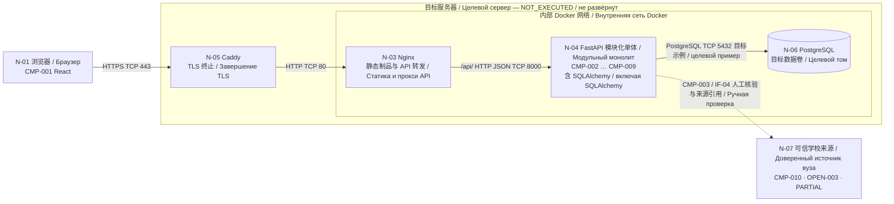
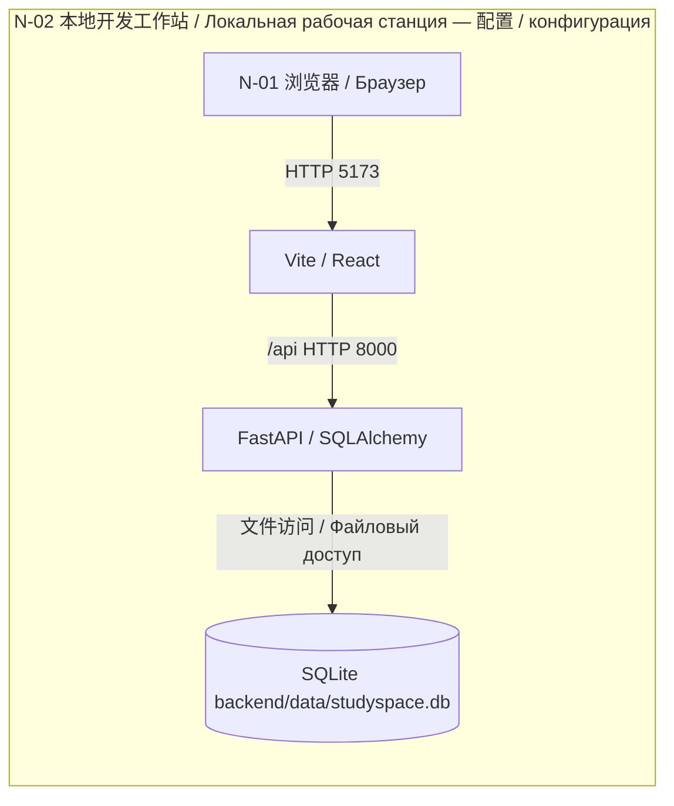

# StudySpace 部署图草案 / Черновик диаграммы развёртывания

Version: 0.1 · Status: DRAFT · Date: 2026-10-21

本次未找到既有独立部署图原件；根据节点与制品表、部署图检查表、ADR-0004、compose.yaml 整理以下草案。草案是本次新增学习材料，未经过教师批准；原有图面核对 PENDING 与实际部署 NOT_EXECUTED 状态保持不变。

Исходная отдельная диаграмма не найдена. Ниже новый учебный черновик по таблице узлов, контрольному списку, ADR-0004 и compose.yaml. Он не согласован преподавателем; прежние статусы PENDING и NOT_EXECUTED сохранены.

## 1 目标部署草案 / Целевой вариант

443 为公开入口，TLS 在 Caddy 终止，内部 HTTP 段没有全链路 TLS。5432 是目标连接示例，数据库不发布公网端口。学校来源是管理员人工核验依赖，未假定自动 SSO/API。服务器位置、域名和最终绑定受 OPEN-010 约束。CMP-002 至 CMP-009 属于同一个后端进程。

443 — публичный вход; TLS завершается в Caddy, внутренние сегменты HTTP без сквозного TLS. 5432 — целевой пример, порт БД не публикуется в Интернет. Источник вуза используется вручную без предположения SSO/API. Сервер, домен и привязки зависят от OPEN-010. CMP-002–CMP-009 работают в одном серверном процессе.

## 2 本地开发配置 / Конфигурация разработки

该图反映配置而非本次服务启动结果。本地 Compose 是另一种运行方式：127.0.0.1:8080 → Nginx → backend:8000 → SQLite；没有 Caddy/PostgreSQL。N-02 直接开发与本地容器方案不要求同时运行。

Это описание конфигурации, а не результат запуска. Другой локальный вариант Compose: 127.0.0.1:8080 → Nginx → backend:8000 → SQLite; без Caddy/PostgreSQL. Прямой запуск N-02 и контейнерный вариант не обязаны работать одновременно.

## 3 来源 / Источники

- [节点与制品表 / Узлы](../02-nodes-environments/StudySpace_节点与制品表_中俄双语_v1.md)
- [部署图检查表 / Контрольный список](StudySpace_部署图检查表_中俄双语_v1.md)
- [ADR-0004](../03-adr/zh-CN/0004-docker-https.md)
- [本地 Compose / Локальный Compose](../00-project/compose.yaml)

Mermaid 源码可编辑；本次只核对节点、协议及状态，图形渲染与教师图面评审未执行。

Исходники Mermaid редактируемы; проверены узлы, протоколы и статусы. Графическая отрисовка и рецензия преподавателя не выполнялись.
