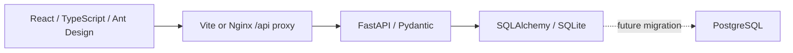

# StudySpace

**Web教室与自习室预约管理系统**  
**Система бронирования учебных аудиторий и мест для самостоятельной работы**

App: **0.1.0** · Requirements: **0.3.0** · API draft: **0.1.0** · Updated: **2026-10-21** · Stage: **REQUIREMENTS CLARIFICATION / УТОЧНЕНИЕ ТРЕБОВАНИЙ**

## 1. 项目与边界 / Проект и границы

中文：面向大学生和学校管理人员的大学软件工程课程项目。MVP查询和管理教室、自习室内的单个座位并预约，预约前必须验证校内身份。现有骨架提供中文、俄语、英语首页、真实API连接状态、健康/数据库就绪检查和基础测试。认证、校内审核、资源管理和预约业务尚未实现；业务输入已根据用户答复及授权澄清，完整SRS仍为 IEEE Std 830-1998 结构的DRAFT，38条需求仍PROPOSED，不声称老师已批准。

Русский: Учебный проект для студентов и сотрудников университета. MVP ищет, управляет и бронирует отдельные места в учебных помещениях; принадлежность к вузу проверяется до бронирования. Каркас содержит китайскую, русскую и английскую страницы, реальное соединение API, проверки работоспособности/готовности БД и базовые тесты. Аутентификация, проверка вуза, ресурсы и бронирование не реализованы. Входные правила уточнены по ответам и делегированию; вся SRS по IEEE Std 830-1998 остаётся DRAFT,38 требований PROPOSED, утверждение преподавателем не заявляется.

中文：课程主角色按图片及此前名单顺序：支浩然（分析员/技术任务书作者）、俞智文（文档编辑）、曹浩然（测试员）、吕嘉伟（项目经理）。允许按主题轮换并记录交接，开发全员协作。默认Asia/Shanghai、每天08:00–22:00、30分钟粒度、最长24小时（默认窗口实际14小时）；同学生预约时段不得重叠，非重叠时段允许多条，含同日及不同未来日；每条仍仅1seat。详见 [需求澄清](docs/zh-CN/16_Requirements_Clarification.md)。

Русский: По изображению и порядку списка: 支浩然 аналитик/авторТЗ,俞智文 редактор,曹浩然 тестировщик,吕嘉伟 менеджер. Роли сменяются по темам с передачей, разработка совместная. Asia/Shanghai,08:00–22:00,30мин,24ч (обычно14ч); интервалы студента не пересекаются, несколько непересекающихся одного/разных будущих дней допустимы, одна запись одноseat. [Уточнение](docs/ru-RU/16_Requirements_Clarification.md).

## 2. 技术架构 / Техническая архитектура

中文：前后端分离、模块化单体。React + TypeScript + Vite + Ant Design前端通过 `/api/v1` HTTP/JSON访问FastAPI；后端使用Pydantic校验与同步SQLAlchemy，开发数据库为SQLite。Vite开发代理与Nginx容器代理统一转发 `/api`。数据库连接字符串可替换，`postgres`可选依赖预留PostgreSQL驱动；迁移脚本、真实PostgreSQL兼容测试和预约并发约束留待后续实施。依赖由 `frontend/package-lock.json` 和 `backend/uv.lock` 固定。

Русский: Раздельные фронтенд и бэкенд, модульный монолит. React + TypeScript + Vite + Ant Design обращается к FastAPI через HTTP/JSON в `/api/v1`; бэкенд использует Pydantic и синхронный SQLAlchemy, при разработке — SQLite. Прокси Vite и контейнерный Nginx направляют `/api` на бэкенд. Строка подключения настраивается; дополнительная зависимость `postgres` предусматривает драйвер PostgreSQL. Скрипты миграции, реальные проверки совместимости PostgreSQL и ограничения конкурентного бронирования ещё предстоит реализовать. Зависимости фиксируются в `frontend/package-lock.json` и `backend/uv.lock`.



## 3. 安装与本地启动 / Установка и локальный запуск

中文：建议Node.js 22.13+（22.x，或24+）、npm、Python 3.13、uv、Git。Docker Compose可选。先检查工具；初始化实测环境和结果见双语报告。命令均在项目根目录执行，脚本首次复制 `.env.example` 到 `.env`，已有 `.env` 不会覆盖。项目依赖安装到本项目的虚拟环境和node_modules；工具下载缓存按各自配置写入，首次下载需要网络。

Русский: Рекомендуются Node.js 22.13+ (ветка 22.x, либо 24+), npm, Python 3.13, uv и Git. Docker Compose необязателен. Сначала проверьте инструменты; фактическая среда и результаты приведены в парном отчёте. Все команды выполняются из корня проекта. При первой установке `.env.example` копируется в `.env`; существующий `.env` сохраняется. Зависимости устанавливаются в виртуальную среду и node_modules проекта; кэш загрузок хранится согласно настройкам инструментов, для первой загрузки нужен интернет.

```bash
cd "/Users/zhi/Documents/软件生命周期/studyspace"
node --version
npm --version
uv --version
git --version
bash scripts/setup.sh
bash scripts/dev.sh
```

中文：首页 [http://127.0.0.1:5173](http://127.0.0.1:5173)，API文档 [http://127.0.0.1:8000/api/v1/docs](http://127.0.0.1:8000/api/v1/docs)。`Ctrl+C`停止两个服务。端口被占用时脚本拒绝启动；不要结束不属于本项目的进程。需要指定已安装Python时，使用 `STUDYSPACE_PYTHON=/path/to/python3.13 bash scripts/setup.sh`。uv缓存默认按工具配置；受限环境可设 `UV_CACHE_DIR=/private/tmp/studyspace-uv-cache` 和 `npm_config_cache=/private/tmp/studyspace-npm-cache`。

Русский: Страница — [http://127.0.0.1:5173](http://127.0.0.1:5173), документация API — [http://127.0.0.1:8000/api/v1/docs](http://127.0.0.1:8000/api/v1/docs). `Ctrl+C` останавливает оба сервиса. При занятом порте скрипт отказывается запускаться; не завершайте чужие процессы. Для выбора установленного Python используйте `STUDYSPACE_PYTHON=/path/to/python3.13 bash scripts/setup.sh`. Для ограниченной среды можно задать `UV_CACHE_DIR=/private/tmp/studyspace-uv-cache` и `npm_config_cache=/private/tmp/studyspace-npm-cache`.

## 4. 验证与可选容器 / Проверка и необязательные контейнеры

```bash
bash scripts/check.sh
python3 scripts/check_docs.py
python3 scripts/generate_registers.py --check
backend/.venv/bin/python scripts/check_api_contract.py
docker compose config --quiet
# Docker Desktop must be running / 需启动Docker / Docker должен быть запущен
docker compose up --build
```

中文：容器首页为 `http://127.0.0.1:8080`。本地开发和容器后端共用8000端口，运行Compose前停止开发服务。`docker compose down` 停止容器；不要使用 `down -v` 删除数据库卷。Compose配置验证不等于镜像构建或部署通过。初始化时Docker守护进程未运行；本轮文档工作未复测容器构建/启动。基础测试通过也不等于业务验收；业务TC保持 NOT_RUN。

Русский: Страница контейнера — `http://127.0.0.1:8080`. Локальный и контейнерный бэкенд используют порт 8000; перед Compose остановите разработку. `docker compose down` останавливает контейнеры; не используйте `down -v`, удаляющий том БД. Проверка конфигурации Compose не подтверждает сборку или развёртывание. При инициализации Docker-демон не был запущен; в этой работе сборка и запуск контейнеров повторно не проверялись. Успешные базовые тесты не означают приёмку бизнес-функций; бизнес-кейсы остаются NOT_RUN.

## 5. 文档与协作 / Документы и совместная работа

中文：正式文档入口 [docs/README.md](docs/README.md)，课程交付入口 [coursework/README.md](coursework/README.md)。21对正式文档在 `docs/zh-CN/`、`docs/ru-RU/`和双语ADR目录；需求、计划测试、用户决定的结构化来源在 `docs/data/`。长期规则见 [AGENTS.md](AGENTS.md)，4人8周计划见 `11_Development_Plan.md`。12项OPEN设计问题已关闭；仅学校真实核验来源、课程具体条件、部署机位/域名三组事项PARTIAL。历史及本轮证据见 [初始化报告](docs/zh-CN/15_Initialization_Report.md) 和 [源文件清单](docs/file-inventory.txt)。

Русский: Официальные документы — [docs/README.md](docs/README.md), учебные материалы — [coursework/README.md](coursework/README.md). 21 пара в `docs/zh-CN/`, `docs/ru-RU/` и парном ADR-каталоге. Источники требований, плановых тестов и решений — `docs/data/`; правила — [AGENTS.md](AGENTS.md), план четырёх участников на8 недель — `11_Development_Plan.md`.12 проектных вопросов закрыты; PARTIAL остаются реальный источник вуза, условия курса, сервер/домен. Исторические и текущие свидетельства: [отчёт](docs/ru-RU/15_Initialization_Report.md), [список исходных файлов](docs/file-inventory.txt).

中文：本地Git仓库初始化于 `main`，尚未提交、配置远程或推送。建议确认骨架与团队方案后作首个 `chore: initialize StudySpace foundation` 提交。后续按 feat:/fix:/docs:/test:/refactor:/chore:，小PR、他人评审、文档同步。未指定开源许可证，发布前由团队决定。

Русский: Локальный Git-репозиторий инициализирован на `main`; коммиты, удалённый репозиторий и отправка не выполнялись. После проверки каркаса и состава команды рекомендуется первый коммит `chore: initialize StudySpace foundation`. Далее используются feat:/fix:/docs:/test:/refactor:/chore:, небольшие PR, независимое ревью и синхронное обновление документов. Лицензия не выбрана; команда должна определить её перед публикацией.

中文：三个业务端点的 [OpenAPI草案](docs/api/openapi.yaml) 与 [契约说明](docs/zh-CN/17_API_Contract.md) 已补齐类型、必填、约束、示例和安全定义；业务尚未实现，契约静态检查不等于业务验收。

Русский: [Черновик OpenAPI](docs/api/openapi.yaml) и [описание](docs/ru-RU/17_API_Contract.md) задают типы, обязательность, ограничения, примеры и защиту трёх точек; бизнес ещё не реализован, статическая проверка не означает приёмку.


### 5.1 需求 架构 API 与测试入口 / Входы в требования архитектуру API и тесты

下表路径均相对于 StudySpace 根目录。本提交件位于 coursework/2026-10-21-readme-v1；Markdown 中的链接可直接打开对应文件。

Пути ниже заданы от корня StudySpace. Эта работа находится в coursework/2026-10-21-readme-v1; ссылки Markdown открывают соответствующие файлы.

| 资料 Материал | 根目录相对路径 Путь от корня |
| --- | --- |
| 总入口与长期规则<br>Общий вход и правила | [项目 README](README.md)<br>[AGENTS](AGENTS.md)<br>[文档目录 Каталог](docs/README.md) |
| 需求与澄清<br>Требования и уточнения | [中文 SRS](docs/zh-CN/03_SRS_IEEE830.md)<br>[Русская SRS](docs/ru-RU/03_SRS_IEEE830.md)<br>[需求源 Реестр](docs/data/requirements.json)<br>[决定 Решения](docs/data/project-decisions.json) |
| 架构与 ADR<br>Архитектура и ADR | [中文设计](docs/zh-CN/04_System_Design.md)<br>[Русский проект](docs/ru-RU/04_System_Design.md)<br>[架构决策 Решения](docs/decisions/README.md) |
| API 契约<br>Контракт API | [OpenAPI YAML](docs/api/openapi.yaml)<br>[中文契约](docs/zh-CN/17_API_Contract.md)<br>[Русский контракт](docs/ru-RU/17_API_Contract.md) |
| 测试设计<br>Проектирование тестов | [中文计划](docs/zh-CN/05_Test_Plan.md)<br>[Русский план](docs/ru-RU/05_Test_Plan.md)<br>[中文用例](docs/zh-CN/06_Test_Cases.md)<br>[Русские сценарии](docs/ru-RU/06_Test_Cases.md)<br>[用例源 Сценарии](docs/data/test-cases.json) |
| 可运行检查与追溯<br>Проверки и трассируемость | [后端测试 Тесты backend](backend/tests/)<br>[文档测试 Тесты документов](tests/)<br>[前端测试 Тест frontend](frontend/src/App.test.tsx)<br>[中文追溯](docs/zh-CN/07_Traceability_Matrix.md)<br>[Русская трассируемость](docs/ru-RU/07_Traceability_Matrix.md) |
| 课程文档网站<br>Учебный сайт документации | [网站项目 Проект сайта](coursework/2026-10-21-docs-as-code-environment-v1/08-sphinx-site/project-docs/README.md)<br>[HTML 首页 Главная](coursework/2026-10-21-docs-as-code-environment-v1/08-sphinx-site/project-docs/site/index.html) |

### 5.2 分支与团队流程 / Ветки и командная работа

main 为集成主线；`feature/<topic>` 用于功能，`fix/<topic>` 用于缺陷，`docs/<topic>` 用于文档。例如 docs/readme。它们是约定，不表示所有分支已创建。本地根仓库当前为尚无首次提交的 main。

main — основная линия интеграции; `feature/<topic>` — функции, `fix/<topic>` — исправления, `docs/<topic>` — документация, например docs/readme. Это соглашение, а не перечень созданных веток. Локальный корневой репозиторий находится на main без первого коммита.

工作顺序：明确任务和关联 ID → 在已建立提交基线后创建主题分支 → 小范围修改并同步中俄文档 → 运行相关检查并记录真实结果 → 提交小批量变更 → 在远程协作已获授权并配置后开 PR → 由另一成员评审 → 经授权合并回 main。

Порядок: определить задачу и ID → после появления базового коммита создать тематическую ветку → внести небольшие изменения и синхронно обновить оба языка → выполнить проверки и записать фактический результат → создать небольшой коммит → после разрешения и настройки удалённой работы открыть PR → получить ревью другого участника → с разрешения слить в main.

提交前缀为 feat:、fix:、docs:、test:、refactor:、chore:。示例 docs: clarify README navigation。需求变更须同步 JSON 来源、测试设计和追溯；未经授权不推送、合并或部署。

Префиксы коммитов: feat:, fix:, docs:, test:, refactor:, chore:. Пример: docs: clarify README navigation. Изменение требований сопровождается обновлением JSON, проекта тестов и трассируемости. Отправка, слияние и развёртывание требуют разрешения.

角色：支浩然为分析员与技术任务书作者；俞智文为文档编辑；曹浩然为测试员；吕嘉伟为项目经理。开发全员协作，主题轮换要记录交接；另一成员的评审不能由自动检查替代。

Роли: 支浩然 — аналитик и автор ТЗ; 俞智文 — редактор; 曹浩然 — тестировщик; 吕嘉伟 — менеджер. Разработка совместная; смена роли по теме фиксируется передачей. Автоматические проверки не заменяют ревью другого участника.

## 6. 目录导航 / Навигация по каталогам

```text
studyspace/
├── frontend/           # React + Vite
├── backend/            # FastAPI + SQLAlchemy + pytest
├── docs/
│   ├── zh-CN/          # Chinese formal drafts
│   ├── ru-RU/          # Russian formal drafts
│   ├── data/           # Proposed requirements and NOT_RUN test plans
│   ├── decisions/      # Paired ADRs
│   └── manifest.json   # Document pairing registry
├── coursework/          # Bilingual classroom deliverables and index
├── tests/              # Documentation consistency tests
├── scripts/            # Setup, dev and checks
├── artifacts/          # Ignored local verification evidence
├── compose.yaml
├── README.md
├── AGENTS.md
├── CHANGELOG.md
└── .env.example
```

## 7. 如何打开和构建文档 / Как открыть и собрать документацию

阅读源码：在 VS Code 打开项目根目录，打开 README.md 或 docs 下的 Markdown，按 Cmd+Shift+V 预览；也可直接打开上表 HTML 首页。网站是独立的课程文档项目，记录已有应用骨架，其 materials 是课程快照；最新正式需求以根目录 docs 为准。

Для чтения открыть корень в VS Code, выбрать README.md либо Markdown из docs и нажать Cmd+Shift+V; можно открыть HTML из таблицы. Сайт — отдельный учебный проект о каркасе приложения, а materials содержит учебные снимки. Актуальные официальные требования находятся в корневом docs.

构建网站：从根目录进入以下目录。已有 .venv 时直接构建；新环境先用 Python 3.13 创建 .venv，再按带哈希的锁文件安装。首次安装需要网络。

Сборка сайта: перейти из корня в каталог ниже. При наличии .venv сразу выполнить сборку; в новой среде создать .venv на Python 3.13 и установить зависимости по lock-файлу с хешами. Первая установка требует сети.

```bash
cd "coursework/2026-10-21-docs-as-code-environment-v1/08-sphinx-site/project-docs"
# 仅新环境执行 / Только для новой среды
python3.13 -m venv .venv
.venv/bin/python -m pip install --require-hashes -r requirements-docs.txt
# 已有环境从此开始 / Для готовой среды начать здесь
bash build-site.sh
.venv/bin/python -m http.server 8765 --bind 127.0.0.1 --directory site
```

然后打开 http://127.0.0.1:8765/，按 Ctrl+C 停止静态服务器。build-site.sh 使用 Sphinx 的 -n -W --keep-going -E -a 严格构建，HTML 写入 site/，日志写入该文档项目的 artifacts/。若 8765 已占用，选择空闲端口。

Затем открыть http://127.0.0.1:8765/; Ctrl+C останавливает сервер. build-site.sh запускает строгую сборку Sphinx с -n -W --keep-going -E -a. HTML записывается в site/, журналы — в artifacts/ проекта документации. Если 8765 занят, выбрать свободный порт.

正式文档一致性检查：在 StudySpace 根目录、应用依赖已安装后执行下列命令。它们检查结构、登记表同步和静态 API 契约；根目录没有统一 Sphinx 构建命令。应用安装与启动方法见根 README 第 3 节。

Проверки официальных документов выполняются из корня StudySpace после установки зависимостей приложения. Они проверяют структуру, синхронизацию реестров и статический контракт API; единой сборки Sphinx в корне нет. Установка и запуск приложения описаны в разделе 3 корневого README.

```bash
backend/.venv/bin/python scripts/check_docs.py
backend/.venv/bin/python scripts/generate_registers.py --check
backend/.venv/bin/python scripts/check_api_contract.py
```

## 8. 已验证的内容与仍在设计的内容 / Что проверено и что ещё проектируется

2026-10-21 在本机实际复核如下。执行命令和原始输出保存于coursework/2026-10-21-readme-v1/artifacts/check-0.json 至 check-3.json；网站复构建输出放在coursework/2026-10-21-readme-v1/artifacts/site，保留原课程网站不变。

Ниже фактические проверки на этом компьютере 2026-10-21. Команды и исходный вывод сохранены в coursework/2026-10-21-readme-v1/artifacts/check-0.json–check-3.json. Повторная сборка сайта записана в coursework/2026-10-21-readme-v1/artifacts/site; прежний сайт сохранён.

| 验证对象 Объект | 结果与边界 Результат и границы |
| --- | --- |
| 正式文档结构<br>Структура документов | PASS：中俄元数据、章节和 ID、需求与测试引用一致。<br>PASS: совпадают метаданные, разделы, ID и ссылки. |
| 登记表与 API<br>Реестры и API | PASS：生成表与 JSON 一致；API 契约静态检查 110 项通过。<br>PASS: реестры совпадают с JSON; 110 статических проверок API пройдены. |
| 文档网站构建<br>Сборка сайта | PASS：Sphinx 严格构建退出码 0，警告日志 0 字节。<br>PASS: строгая сборка Sphinx, код 0, журнал предупреждений 0 байт. |
| 业务功能与验收<br>Бизнес-функции и приёмка | NOT_IMPLEMENTED / NOT_RUN：认证、核验、资源和预约尚未实现；未进行真实业务验收。<br>NOT_IMPLEMENTED / NOT_RUN: аутентификация, проверка вуза, ресурсы и бронирование не реализованы; бизнес-приёмка не проведена. |
| 本轮未执行<br>Сейчас не выполнялось | 应用完整检查 scripts/check.sh、容器部署、真实学校核验、HTTPS、迁移与并发验收。<br>Полная проверка приложения scripts/check.sh, контейнерное развёртывание, проверка вуза, HTTPS, миграция и конкурентная приёмка. |

健康接口可连接、文档构建成功或静态契约通过，均不能把业务 TC 改为 PASS。SRS 与正式文档仍为 DRAFT，需求仍为 PROPOSED；翻译语义、团队评审和教师批准须另有证据。

Доступность health API, сборка документации и статические проверки не переводят бизнес-TC в PASS. SRS и официальные документы остаются DRAFT, требования — PROPOSED. Смысл перевода, командное ревью и одобрение преподавателя требуют отдельных свидетельств.

未完成的外部前提为 OPEN-003 学校真实核验来源、OPEN-008 课程具体条件、OPEN-010 部署位置与域名。提醒、签到、违约和使用率为未来范围 FR-018 至 FR-021。

Незавершённые внешние условия: OPEN-003 — источник проверки вуза, OPEN-008 — условия курса, OPEN-010 — сервер и домен. Напоминания, присутствие, нарушения и загрузка относятся к будущим FR-018–FR-021.

## 9. 仓库中不保存什么 / Что не хранится в репозитории

禁止提交真实密码、API 密钥、访问令牌、私钥、生产 .env、学生身份材料和真实个人数据、数据库与备份、生产日志及带敏感信息的截图。可提交不含真实秘密的 .env.example 与明确标记的合成样例。提交前人工复核，不能仅依赖忽略规则。

Не коммитить реальные пароли, API-ключи, токены, закрытые ключи, рабочий .env, документы студентов и персональные данные, БД и резервные копии, производственные журналы и снимки с секретами. Допустимы .env.example без секретов и явно обозначенные синтетические примеры. Перед коммитом нужна ручная проверка; одного ignore недостаточно.

现有 .gitignore 排除 .env 及其变体（保留 .env.example）、.venv/、node_modules/、dist/、缓存、*.db 与 *.sqlite* 数据、backend/data/、*.log、.DS_Store、根 artifacts/ 与 .gstack/ 等。依赖环境和应用构建产物应按锁文件重建。

Текущий .gitignore исключает .env и варианты, сохраняя .env.example, а также .venv/, node_modules/, dist/, кэши, БД *.db и *.sqlite*, backend/data/, *.log, .DS_Store, корневой artifacts/ и .gstack/. Среды и сборки приложения воспроизводятся по lock-файлам.

2026-10-21 按后续课堂任务补齐 `site/`、`docs/_build/`、`**/bin/`、`**/obj/`、`TestResults/` 和 `Thumbs.db`。生成的网站保留在本机，`site/` 由 Git 忽略，可按第 7 节重新构建；文档源码、依赖锁文件与 `.env.example` 仍可纳入版本管理。脱敏后的课程证据与 DOCX 按提交用途保留，不能假定所有嵌套 `artifacts/` 都被忽略；渲染中间 PNG/PDF 不作为提交正文。

2026-10-21 по следующему заданию добавлены `site/`, `docs/_build/`, `**/bin/`, `**/obj/`, `TestResults/` и `Thumbs.db`. Сайт сохранён локально; `site/` исключается Git и пересобирается по разделу 7. Исходники документов, lock-файлы и `.env.example` остаются доступными для версионного контроля. Обезличенные учебные свидетельства и DOCX сохраняются по назначению; не все вложенные `artifacts/` автоматически исключены. Промежуточные PNG/PDF не входят в основной результат сдачи.

课堂六项 README 提交版 / Учебная версия README по шести пунктам: [Markdown](coursework/2026-10-21-readme-v1/README.md) · [Word](coursework/2026-10-21-readme-v1/StudySpace_README_中俄双语_v1.docx)。

依据 / Источники: [IEEE Std 830-1998](https://standards.ieee.org/standard/830-1998.html), [Vite Guide](https://vite.dev/guide/), [FastAPI First Steps](https://fastapi.tiangolo.com/tutorial/first-steps/), [SQLAlchemy 2.0](https://docs.sqlalchemy.org/en/20/).
